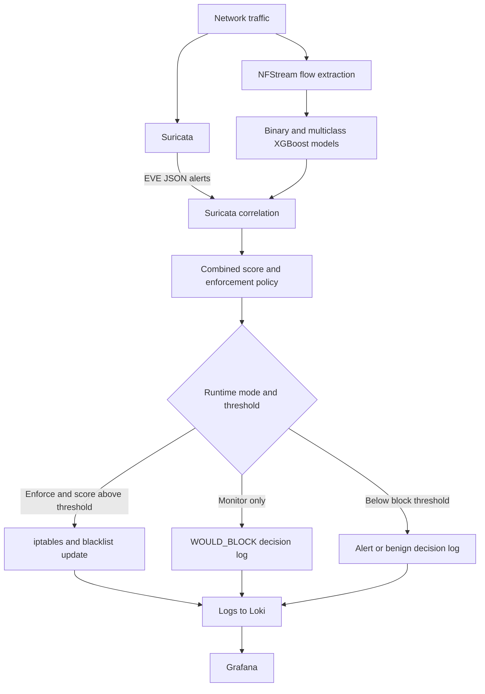

# IDPS - Machine Learning-Based Intrusion Detection and Prevention System

A research and lab deployment combining NFStream flow extraction, XGBoost classification, Suricata alert correlation, and automated IP blocking with `iptables`. Grafana and Loki provide monitoring. Offline classification results do not establish zero-day detection or a guaranteed live response time.

## Contents

- [Current model and runtime](#current-model-and-runtime)
- [System architecture](#system-architecture)
- [Project structure](#project-structure)
- [Installation and launch](#installation-and-launch)
- [Evaluation results](#evaluation-results)
- [Monitoring with Grafana](#monitoring-with-grafana)
- [Tests and training data](#tests-and-training-data)
- [License](#license)

## Current model and runtime

The Docker deployment mounts [`models/`](models/) into the daemon. Its checked-in artifacts match experiment **`20260908_botnet_excluded_v1`**:

- **21 selected input features**, in the order recorded in [`model_metadata.json`](models/model_metadata.json).
- **Five classes**: `BENIGN`, `Brute Force`, `DoS/DDoS`, `PortScan`, and `Web Attack`. Botnet, Infiltration, and Heartbleed were excluded from this supervised training scope.
- A binary classifier and a multiclass classifier both run on each eligible flow. The ML confidence is `max(binary attack probability, 1 - multiclass BENIGN probability)`.
- The daemon adds Suricata correlation evidence, caps the combined score at 1.0, and supports a Suricata enforcement override. In enforce mode, a final score **greater than 0.85** requests blocking, subject to IP protections and firewall success.
- [`thresholds.json`](configs/thresholds.json) currently sets the alert threshold to **0.60**, the Suricata-only correlation cap when ML is benign to **0.30**, and the ban duration to **60 seconds**.
- `MONITOR_ONLY_MODE=true` retains inference and decision logging while disabling daemon firewall and blacklist writes. `SURICATA_ONLY_MODE=true` bypasses ML inference; these two modes cannot be enabled together.

The separate [`20260913_connection_count_10s_v2`](experiments/20260913_connection_count_10s_v2/) experiment also has 21 selected features, including a causal 10-second Connection Count. Its artifacts are **not the default files in `models/`**. The runtime reads the mounted model metadata to select the feature schema.

Runtime dependencies are defined in [`docker/autodefense/requirements.txt`](docker/autodefense/requirements.txt), including **NFStream 6.5.3** and **XGBoost 3.2.0**. The daemon image uses Python 3.10. Suricata is installed from the OISF stable PPA without a pinned version; the monitoring images and Juice Shop use `latest` tags.

## System architecture



In enforce mode, existing blacklist and whitelist checks precede ML inference. Suricata listens on the external interface and the `br-idps` Docker bridge; NFStream defaults to `ens33`. Nginx terminates TLS and proxies traffic to the Juice Shop lab application, allowing Suricata to observe plaintext traffic on the bridge.

Flow processing is not packet-by-packet classification. The extractor uses a **10-second idle timeout** and a **30-second active timeout**. Model inference, flow export, decision processing, and firewall enforcement are distinct latency measurements.

## Project structure

```text
IDPS/
├── configs/                  # Thresholds, whitelist and blacklist
├── datasets/                 # Split script; large datasets are excluded from Git
├── docker/
│   ├── autodefense/           # Python daemon image and runtime dependencies
│   ├── grafana/provisioning/  # Dashboard and Loki datasource
│   ├── nginx/                # TLS reverse proxy for the lab application
│   ├── suricata/             # IDS image and custom rules
│   └── docker-compose.yml
├── experiments/              # Model variants, metadata and evaluation artifacts
├── figures/                  # Architecture and result figures
├── models/                   # Default models, encoder and model_metadata.json
├── reports/                  # Implementation and live-test reports
├── results/                  # Historical reports and figures
├── src/
│   ├── autodefense_daemon.py  # Flow processing and enforcement decisions
│   ├── realtime_extractor.py # Model-aware feature extraction
│   ├── connection_count.py   # Shared offline/live connection-count contract
│   ├── threat_evaluator.py   # Binary and multiclass inference
│   ├── suricata_correlator.py
│   ├── decision_policy.py    # Enforcement/monitor-only side-effect boundary
│   ├── auto_firewall.py
│   ├── ip_manager.py
│   └── run_botnet_excluded_experiment.py
└── tests/                    # Unit tests, evaluation tools and lab scenarios
```

Logs, Docker runtime data, large CSV/PCAP inputs, and local drafts are excluded from Git. The `logs/` directory is created locally for runtime use.

## Installation and launch

Use a Linux host with Docker Engine, Docker Compose v2 (`docker compose`), and Git installed. The Compose deployment uses Linux host networking, packet capture, and `NET_ADMIN`/`NET_RAW` capabilities.

```bash
git clone https://github.com/DuongMinhTien22ba13297/IDPS.git
cd IDPS
mkdir -p logs/suricata docker/loki/data docker/grafana/data
```

Before starting, adapt the checked-in lab configuration:

1. In [`docker/docker-compose.yml`](docker/docker-compose.yml), replace the Grafana/Loki bind address `192.168.226.151` with an address present on your host. The published ports are 3000 and 3100.
2. Check the capture interface using `ip link show`. If it is not `ens33`, update Suricata's `IFACE` value while retaining the bridge capture (`-i br-idps`), and add `IFACE=<your-interface>` to the **autodefense service environment**. Setting it only in the host shell does not pass it to that container with the current Compose file.
3. Update [`configs/whitelist.json`](configs/whitelist.json) for your management IPs and review [`configs/blacklist.json`](configs/blacklist.json). In enforce mode, whitelisted sources bypass inference.
4. Make the Grafana data directory writable by the container user. With the standard Grafana image user, this can be prepared with `sudo chown -R 472:472 docker/grafana/data`.
5. Set `GRAFANA_PASSWORD` in the shell or in `docker/.env`. The Compose fallback is `admin`; it configures the initial Grafana admin password.

Start in monitor-only mode to inspect decisions:

```bash
cd docker
MONITOR_ONLY_MODE=true docker compose up -d --build
docker compose ps
docker compose logs --tail=100 autodefense suricata
```

To enable enforcement after reviewing the interface and whitelist settings:

```bash
MONITOR_ONLY_MODE=false docker compose up -d autodefense
```

If the shell cannot access Docker, run the Compose commands with appropriate privileges. Enforce mode modifies the host firewall. The stack also exposes an intentionally vulnerable Juice Shop application on port 3001 and through Nginx on ports 80/443; run it in a controlled lab. Nginx generates a self-signed TLS certificate.

## Evaluation results

The following values describe the **default checked-in model**, experiment `20260908_botnet_excluded_v1`, on **330,125 held-out CICIDS2017-derived flows**. They come from [`final_evaluation.json`](experiments/20260908_botnet_excluded_v1/results/final_evaluation.json) and its [experiment report](experiments/20260908_botnet_excluded_v1/results/experiment_report.md).

| Measurement | Value | Scope |
|---|---:|---|
| Binary accuracy | 99.6483% | Binary component |
| Binary attack recall | 99.8993% | TP / (TP + FN), from the binary confusion matrix |
| Binary false positive rate | 0.4492% | FP / (TN + FP) |
| Binary weighted F1 | 0.996489 | Binary component |
| Multiclass accuracy | 99.6398% | Five-class component |
| Multiclass macro F1 | 0.990701 | Five-class component |
| Dual-model ML accuracy | 99.5741% | Offline ML fusion at threshold 0.85 |
| Dual-model ML macro F1 | 0.971550 | Offline ML fusion at threshold 0.85 |
| Dual-model ML attack FPR | 0.4450% | Offline ML fusion at threshold 0.85 |
| Dual-model ML attack FNR | 0.3605% | Offline ML fusion at threshold 0.85 |

The experiment uses an approximately 80/20 chronological split within each mapped class, assigning equal boundary timestamps to the final test. It uses five-fold cross-validation on development data for model selection. SMOTE targets Brute Force and Web Attack within the training process. See [data lineage](experiments/20260908_botnet_excluded_v1/results/data_lineage.json) for the scope, filtering and split details.

The ML-fusion results above exclude live Suricata correlation and firewall actions. The JSON also records **amortized bulk inference** timings: approximately **0.201 microseconds/flow** for binary `predict_proba` and **0.756 microseconds/flow** for multiclass `predict_proba`. These averages over batches of 330,125 flows exclude feature extraction, flow timeout, serialization, Suricata and firewall actions. They do not establish single-flow runtime latency or a sub-100 ms detection-to-block guarantee. Live latency fields are documented and exercised in [`tests/test_latency_metrics.py`](tests/test_latency_metrics.py).

Historical reports in `results/` and other experiment folders may describe different feature sets, class scopes and model versions.

## Monitoring with Grafana

With the checked-in port binding, Grafana is at **http://192.168.226.151:3000**, rather than `localhost:3000`. Use the address you configured during setup. The initial username is `admin`; the password is `GRAFANA_PASSWORD`, falling back to `admin` for a fresh Grafana data directory.

The provisioned **Zero-Touch IDPS Overview** dashboard refreshes every **5 seconds** and includes flow rate, per-flow ML/correlation/decision records, top source IPs, threat logs, and the latest per-flow multiclass probabilities. Grafana connects to Loki through `http://loki:3100` on the Compose network.

## Tests and training data

For a Python environment with the runtime dependencies available, run from the repository root:

```bash
python -m unittest discover -s tests -p 'test_*.py'
```

Two tests read `experiments/20260913_connection_count_10s_v2/data/final_test.csv`. That large file is excluded from Git, so the full suite requires the corresponding local experiment data; a fresh clone alone does not contain that fixture. The shell scenarios under `tests/` require a running Linux lab.

Training is separate from the Docker runtime. [`src/run_botnet_excluded_experiment.py`](src/run_botnet_excluded_experiment.py) requires the local input `datasets/cic2017_nfs_labeled_57features.csv` and additional packages including `imbalanced-learn`, `lightgbm`, and `optuna`. Its current default experiment ID is `20260913_connection_count_10s_v2`. It does not automatically replace the default `models/` artifacts. The root `run_training_pipeline.*` scripts reference legacy stages that are absent from this checkout and are not the current training entry point.

## License

Distributed under the [MIT License](LICENSE).

- **Author:** Duong Minh Tien
- **Repository:** [IDPS](https://github.com/DuongMinhTien22ba13297/IDPS)
