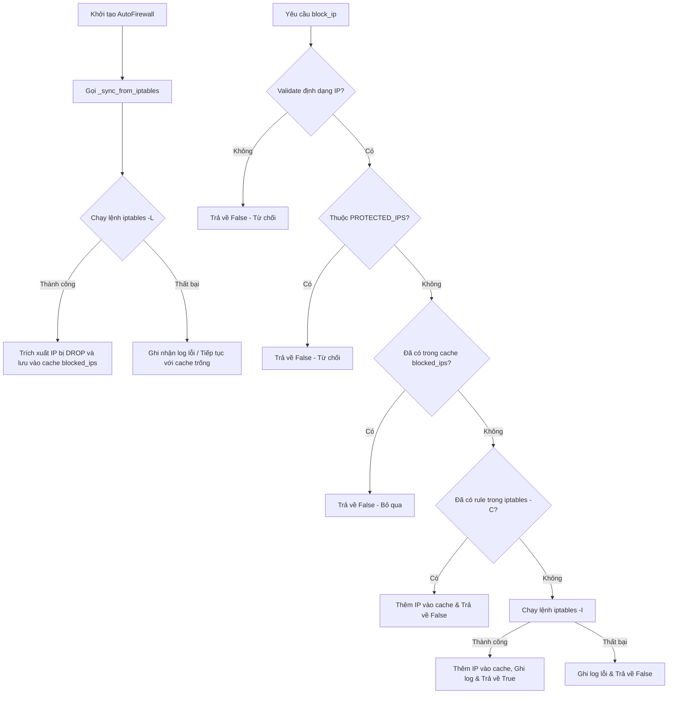

# Báo Cáo Chi Tiết Script: `src/auto_firewall.py`

## 1. Thông Tin Chung
- **Tên script**: [auto_firewall.py](file:///c:/IDPS/src/auto_firewall.py)
- **Class chính**: `AutoFirewall`
- **Mục tiêu**: Cung cấp giao diện lập trình (API) để quản lý động danh sách IP bị chặn và bỏ chặn bằng cách tương tác trực tiếp với tường lửa `iptables` trên hệ thống Linux.

---

## 2. Chức Năng Chính
`AutoFirewall` đóng vai trò là "cánh tay thực thi" của hệ thống IDPS. Khi các module khác (như `autodefense_daemon.py`) phát hiện một địa chỉ IP có hành vi tấn công với độ tin cậy vượt ngưỡng cho phép, `AutoFirewall` sẽ nhận tín hiệu và cấu hình lại tường lửa hệ thống để chặn ngay lập tức toàn bộ lưu lượng đến từ IP đó.

Các tính năng nổi bật:
- **Đồng bộ trạng thái (State Synchronization)**: Khi khởi tạo, nó đọc trực tiếp các rule `iptables` hiện có của hệ thống để đồng bộ hóa cache cục bộ. Điều này đảm bảo tính nhất quán ngay cả khi container hoặc daemon khởi động lại.
- **Kiểm tra tính hợp lệ (IP Validation)**: Kiểm tra định dạng IP để ngăn chặn nguy cơ Command Injection qua tham số dòng lệnh.
- **Bảo vệ IP cốt lõi (Protected IPs)**: Chứa danh sách cố định các IP quan trọng (như Loopback, Host machine, Gateway) để tránh việc tự chặn chính mình (Self-denial of service).
- **Kiểm tra trùng lặp (Duplicate Rule Prevention)**: Tránh việc chèn các rule trùng lặp vào tường lửa gây quá tải hoặc làm chậm xử lý mạng.
- **Tự động giới hạn thời gian (Timeout Control)**: Mỗi lệnh gọi `iptables` được giới hạn tối đa trong 1 giây để tránh nghẽn luồng xử lý.

---

## 3. Đầu Vào (Input)
- **Từ các hàm API của class**:
  - `src_ip` (str): Địa chỉ IPv4 cần chặn (`block_ip`) hoặc bỏ chặn (`unblock_ip`).
  - `reason` (str): Lý do thực hiện chặn (dùng cho việc ghi nhật ký hệ thống).
- **Từ hệ thống (System State)**:
  - Kết quả lệnh `iptables -L INPUT -n --line-numbers`: Danh sách các rule tường lửa hiện tại để đồng bộ cache khi khởi tạo.
  - Kết quả lệnh `iptables -C INPUT -s {src_ip} -j DROP`: Kiểm tra sự tồn tại của rule tường lửa đối với IP cụ thể.

---

## 4. Đầu Ra (Output)
- **Hành động hệ thống**:
  - Chèn rule chặn IP: `iptables -I INPUT -s {src_ip} -j DROP`
  - Xóa rule chặn IP: `iptables -D INPUT -s {src_ip} -j DROP`
- **Bộ nhớ trong (In-memory cache)**:
  - Cập nhật biến `self._blocked_ips` (kiểu `set`) chứa danh sách các IP đang bị chặn.
- **Thông tin phản hồi (Return values)**:
  - Trả về `True` hoặc `False` để báo cáo hành động thực hiện thành công hay thất bại.
- **Ghi nhật ký (Logs)**: Ghi log qua Logger `Autodefense.AutoFirewall` bao gồm:
  - `AUTO_BLOCKED: {src_ip} | Lý do: {reason}` khi chặn thành công.
  - `UNBLOCKED: {src_ip}` khi bỏ chặn thành công.
  - Các log lỗi hoặc cảnh báo nếu lệnh `iptables` gặp timeout hoặc lỗi đặc quyền (ví dụ: thiếu quyền root).

---

## 5. Cơ Chế Hoạt Động



### Chi tiết luồng xử lý:

1. **Khởi tạo và Đồng bộ**:
   Khi class `AutoFirewall` được khởi tạo, hàm `_sync_from_iptables` được kích hoạt. Nó sử dụng `subprocess.run` để chạy lệnh:
   ```bash
   iptables -L INPUT -n --line-numbers
   ```
   Dữ liệu trả về sẽ được phân tích theo dòng. Các dòng chứa hành động `DROP` và cột IP tương ứng sẽ được lọc ra. Địa chỉ IP sẽ được chuyển qua hàm `_is_valid_ip` để kiểm tra tính hợp lệ trước khi nạp vào `self._blocked_ips`.

2. **Chặn IP (`block_ip`)**:
   - **Bước 1**: Xác thực địa chỉ IP thông qua thư viện chuẩn `ipaddress` (hàm `_is_valid_ip`). Nếu IP không đúng định dạng (ví dụ: chứa ký tự lạ nhằm mục đích Command Injection), lệnh chặn bị từ chối ngay.
   - **Bước 2**: Đối chiếu với `PROTECTED_IPS` chứa danh sách các IP không bao giờ được chặn:
     - `127.0.0.1` (Localhost)
     - `192.168.226.1` (Default Gateway của máy ảo)
     - `192.168.226.151` (Địa chỉ IP của chính Server chạy IDPS)
   - **Bước 3**: Kiểm tra xem IP này đã nằm trong cache bộ nhớ `self._blocked_ips` chưa. Nếu có, bỏ qua để giảm số lượng lệnh hệ thống không cần thiết.
   - **Bước 4**: Kiểm tra trực tiếp trên `iptables` bằng lệnh `iptables -C INPUT -s {src_ip} -j DROP` (hàm `_check_rule_exists`). Nếu lệnh này trả về mã lỗi 0 (nghĩa là rule đã tồn tại sẵn), IP sẽ được đưa ngược lại vào cache bộ nhớ và bỏ qua bước chèn.
   - **Bước 5**: Chèn rule chặn ở vị trí đầu tiên của chuỗi `INPUT` (đảm bảo ưu tiên cao nhất) bằng lệnh:
     ```bash
     iptables -I INPUT -s {src_ip} -j DROP
     ```
     Nếu lệnh chạy thành công trong vòng 1 giây, IP được thêm vào `self._blocked_ips`, ghi nhận log thông báo và trả về `True`.

3. **Bỏ chặn IP (`unblock_ip`)**:
   - Xác thực IP đầu vào.
   - Gọi lệnh hệ thống để xóa rule:
     ```bash
     iptables -D INPUT -s {src_ip} -j DROP
     ```
   - Nếu thành công, loại bỏ IP khỏi `self._blocked_ips` bằng hàm `discard` và ghi nhận log `UNBLOCKED`.

> [!WARNING]
> Do script gọi trực tiếp công cụ `iptables` của hệ điều hành, nó yêu cầu phải được chạy dưới quyền quản trị (`root`) hoặc chạy bên trong Docker Container có cấu hình `privileged: true` hoặc cấp quyền `NET_ADMIN`. Nếu chạy trên Windows, các lệnh `iptables` sẽ thất bại và ghi log lỗi `FileNotFoundError`.
