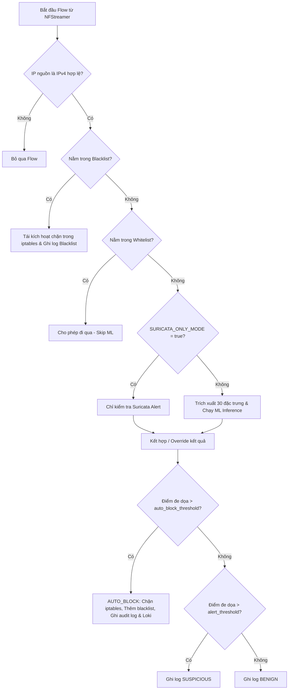

# Báo Cáo Chi Tiết Script: `src/autodefense_daemon.py`

## 1. Thông Tin Chung
- **Tên script**: [autodefense_daemon.py](file:///c:/IDPS/src/autodefense_daemon.py)
- **Mục tiêu**: Là dịch vụ nền (Core Daemon) chạy liên tục của hệ thống Zero-Touch IDPS. Script này kết nối toàn bộ các thành phần (bắt luồng mạng, trích xuất đặc trưng, dự đoán ML, phân tích luật Suricata, quản lý IP và điều khiển tường lửa) để thực hiện quy trình phát hiện và phản ứng tự động thời gian thực.

---

## 2. Chức Năng Chính
`autodefense_daemon.py` là trung tâm điều phối của hệ thống IDPS, thực hiện quy trình khép kín từ thu thập thông tin đến xử lý sự kiện:
- **Lắng nghe lưu lượng trực tiếp (Real-time Capture)**: Sử dụng thư viện `NFStream` để bắt các gói tin trên card mạng vật lý hoặc ảo, nhóm chúng thành các luồng mạng (flows) hai chiều.
- **Quy trình Lọc và Phân tích Đa Tầng**:
  - **Tầng 1 (Chặn sớm - Early Drop)**: Lọc các IP đã có trong danh sách đen (Blacklist) để giảm tải cho hệ thống ML.
  - **Tầng 2 (Bỏ qua - Whitelist Bypass)**: Cho phép lưu lượng từ các IP tin cậy (Whitelist) đi qua mà không cần phân tích.
  - **Tầng 3 (Dự đoán ML & Tương quan Suricata - ML & L7 Fusion)**: Kết hợp kết quả dự đoán từ mô hình Machine Learning với các cảnh báo chữ ký từ Suricata (DPI) để đưa ra điểm số đe dọa tổng hợp.
- **Tự Động Phản Ứng (Zero-Touch Response)**: Ra quyết định chặn IP tự động trên tường lửa mà không cần sự can thiệp của con người khi điểm đe dọa vượt quá ngưỡng.
- **Giám sát trực quan (Monitoring & Telemetry)**: Đẩy log cấu trúc JSON tới hệ thống giám sát Grafana/Loki để hiển thị dashboard thời gian thực và ghi nhật ký kiểm toán (Audit Trail) phục vụ điều tra sự cố.
- **Chế độ kiểm thử (A/B Testing Mode)**: Hỗ trợ chạy ở chế độ chỉ sử dụng Suricata (`SURICATA_ONLY_MODE`) để so sánh hiệu quả giữa phương pháp truyền thống và phương pháp tích hợp ML.

---

## 3. Đầu Vào (Input)
- **Lưu lượng mạng (Network Traffic)**: Các gói tin đi qua Network Interface (được cấu hình bởi biến môi trường `IFACE`, mặc định là `ens33`).
- **Biến môi trường cấu hình (Environment Variables)**:
  - `IFACE`: Tên card mạng cần bắt gói (ví dụ: `ens33`).
  - `MODELS_DIR`: Thư mục chứa các file mô hình XGBoost (mặc định: `/app/models`).
  - `CONFIG_DIR`: Thư mục chứa whitelist, blacklist và các file cấu hình ngưỡng (mặc định: `/app/configs`).
  - `LOKI_URL`: URL API để đẩy log lên hệ thống Loki (mặc định: `http://192.168.226.151:3100/loki/api/v1/push`).
  - `SURICATA_EVE_PATH`: Đường dẫn tới file nhật ký cảnh báo EVE JSON của Suricata (mặc định: `/app/logs/suricata/eve.json`).
  - `SURICATA_ONLY_MODE`: Biến boolean (`true`/`false`) để bật chế độ chạy kiểm thử chỉ dùng Suricata.
- **Dữ liệu cấu hình cục bộ**: Các file JSON như `blacklist.json`, `whitelist.json` và cấu hình mô hình `thresholds.json`.

---

## 4. Đầu Ra (Output)
- **Chặn tường lửa**: Lệnh chèn luật DROP IP gửi tới `AutoFirewall` để thực thi trên `iptables`.
- **Cập nhật danh sách đen**: Ghi nhận IP tấn công vào file cấu hình `blacklist.json` thông qua `IPManager`.
- **Nhật ký hệ thống (Logs)**:
  - `/app/logs/autodefense.log`: Log hoạt động chi tiết của Daemon (tiến trình khởi chạy, trạng thái kết nối Loki, thống kê định kỳ).
  - `/app/logs/action_audit.log`: Log cấu trúc dạng JSON-line ghi lại tất cả các hành động chặn IP (phục vụ Audit Trail).
  - **Grafana/Loki Push**: Gửi log sự kiện trực tiếp lên Loki Server bằng HTTP POST.

---

## 5. Cơ Chế Hoạt Động

### 5.1 Sơ đồ Quy trình Xử lý Luồng (Event-Driven Pipeline)



### 5.2 Các bước xử lý chi tiết

1. **Giai đoạn khởi tạo (`main`)**:
   - Khởi tạo `IPManager` để nạp danh sách IP trắng/đen.
   - Khởi tạo `ThreatEvaluator` để load mô hình XGBoost nhị phân và đa lớp vào RAM.
   - Khởi tạo `AutoFirewall` để đồng bộ trạng thái `iptables` hiện tại.
   - Khởi chạy luồng giám sát file log Suricata EVE JSON qua `SuricataCorrelator`.
   - Khởi động `NFStreamer` trên card mạng chỉ định (có cơ chế thử lại tối đa 10 lần, giãn cách lũy thừa nếu card mạng chưa sẵn sàng).

2. **Xử lý mỗi luồng mạng (`process_flow`)**:
   - **Lọc sớm**: Kiểm tra IP nguồn. IPv6 và IP `0.0.0.0` bị loại bỏ.
   - **Tầng 1 - Blacklist Check**: Nếu IP nguồn nằm trong blacklist, daemon sẽ gọi `AutoFirewall` để thực thi lại lệnh chặn iptables (phòng trường hợp rule bị mất đột ngột) và ghi log cảnh báo, sau đó kết thúc xử lý flow.
   - **Tầng 2 - Whitelist Check**: Nếu IP nằm trong whitelist, bỏ qua phân tích ML và cho phép đi qua.
   - **Tầng 3 - Đánh giá Đe dọa (Inference & Correlation)**:
     - **Chế độ Full System**:
       - Script chuyển đổi flow của `NFStream` thành vector 30 đặc trưng mạng.
       - Mô hình ML nhị phân dự đoán khả năng tấn công (`binary_score`). Nếu > `threshold`, mô hình đa lớp dự đoán loại hình tấn công (`attack_type`) và độ tin cậy.
       - Giao tiếp với `SuricataCorrelator` để truy vấn xem IP và Port này có kích hoạt cảnh báo Signature-based nào trong thời gian gần đây không.
       - **Thuật toán Fusion**: Điểm tin cậy cuối cùng = Điểm ML + Điểm tương quan Suricata. Nếu Suricata trả về luật chặn ở mức ứng dụng (L7 Drop Rule), kết quả ML sẽ bị ghi đè (override) và điểm tin cậy được nâng lên tối thiểu 0.90.
     - **Chế độ Suricata-only**: Bỏ qua ML, điểm đe dọa và loại tấn công hoàn toàn phụ thuộc vào việc Suricata có khớp Signature hay không.
   - **Tầng 4 - Quyết định và Thực thi**:
     - Điểm tin cậy cuối cùng được so sánh với hai ngưỡng:
       - **Ngưỡng chặn tự động (`auto_block_threshold`)**: Nếu vượt ngưỡng, daemon sẽ gọi `AutoFirewall` chặn IP, ghi nhận IP vào blacklist file, ghi nhận sự kiện vào file audit log dạng JSON và gửi cảnh báo dạng cấu trúc lên Grafana/Loki.
       - **Ngưỡng cảnh báo (`alert_threshold`)**: Nếu nằm giữa ngưỡng cảnh báo và ngưỡng chặn, hệ thống chỉ ghi log `SUSPICIOUS` kèm chi tiết điểm số để quản trị viên giám sát.
       - Dưới ngưỡng này, luồng được ghi nhận là `BENIGN`.

> [!IMPORTANT]
> Nhật ký kiểm toán hành động chặn (`action_audit.log`) sử dụng định dạng JSON chuẩn để dễ dàng tích hợp với các hệ thống SIEM hoặc phân tích tập trung:
> ```json
> {
>   "timestamp": "2026-06-11T10:23:00.000Z",
>   "attacker_ip": "192.168.226.130",
>   "target_port": 80,
>   "ml_confidence_score": 0.985,
>   "predicted_threat": "DoS-GoldenEye",
>   "system_action": "AUTO_BLOCKED",
>   "response_time_ms": 15.4
> }
> ```
