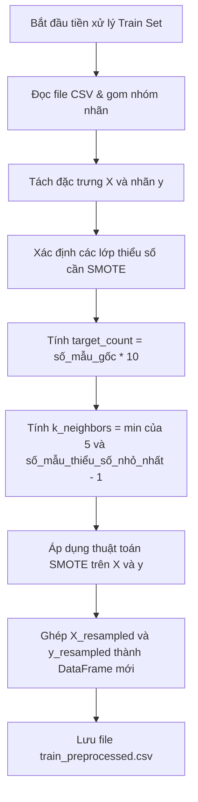

# Báo Cáo Chi Tiết Script: `src/data_preprocessing.py`

## 1. Thông Tin Chung
- **Tên script**: [data_preprocessing.py](file:///c:/IDPS/src/data_preprocessing.py)
- **Mục tiêu**: Thực hiện tiền xử lý dữ liệu thô (sau khi đã được làm sạch sơ bộ) để phục vụ cho việc huấn luyện mô hình học máy. Script thực thi hai nhiệm vụ cốt lõi: Gom nhóm nhãn tấn công (Label Mapping) và Cân bằng dữ liệu lớp thiểu số (Oversampling bằng SMOTE).

---

## 2. Chức Năng Chính
`data_preprocessing.py` đảm bảo chất lượng và sự ổn định của tập dữ liệu huấn luyện:
- **Gom nhóm nhãn (Label Mapping)**: Tập dữ liệu gốc CIC-IDS-2017 chứa 15 nhãn tấn công nhỏ lẻ với số lượng mẫu phân tán lớn. Script gom chúng về 7 lớp đại diện chính để nâng cao hiệu năng phân loại của mô hình đa lớp.
- **Xử lý mất cân bằng dữ liệu (SMOTE Oversampling)**: Trong an ninh mạng, số mẫu tấn công (thiểu số) thường rất nhỏ so với số mẫu bình thường (đa số). Script áp dụng thuật toán SMOTE để sinh thêm dữ liệu nhân tạo cho các lớp thiểu số lên 10 lần, đồng thời giữ nguyên phân phối lớp đa số (`BENIGN` và `DoS/DDoS`) để mô hình không bị thiên lệch (bias) nhưng vẫn phản ánh đúng thực tế lưu lượng mạng.
- **Tối ưu hóa tài nguyên (Memory Management)**: Quá trình xử lý tập dữ liệu lớn (~hàng triệu dòng) dễ gây tràn RAM. Script tối ưu bằng cách ép kiểu dữ liệu (`astype`), xóa các biến không dùng tới ngay lập tức (`del`) và kích hoạt bộ dọn rác của Python (`gc.collect()`).

---

## 3. Đầu Vào (Input)
- **Các tệp tin CSV thô**:
  - `datasets/cic2017_train_80.csv`: Tập dữ liệu huấn luyện gốc (chiếm 80% tổng dữ liệu).
  - `datasets/cic2017_test_20.csv`: Tập dữ liệu kiểm thử gốc (chiếm 20% tổng dữ liệu).

---

## 4. Đầu Ra (Output)
- **Các tệp tin CSV đã xử lý**:
  - `datasets/cic2017_train_80_preprocessed.csv`: Dữ liệu huấn luyện đã được gom nhóm nhãn và nhân bản lớp thiểu số qua SMOTE.
  - `datasets/cic2017_test_20_preprocessed.csv`: Dữ liệu kiểm thử đã gom nhóm nhãn (giữ nguyên phân phối mẫu, không chạy SMOTE).
- **Thống kê trên Terminal**: In ra bảng phân bố nhãn chi tiết trước và sau khi thực hiện SMOTE, cùng dung lượng tệp tin đầu ra (MB) để giám sát tiến độ.

---

## 5. Cơ Chế Hoạt Động

### 5.1 Quy trình gom nhóm nhãn (`map_label`)

Hàm `map_label` ánh xạ các chuỗi nhãn chi tiết trong dataset gốc về các nhóm tổng quan hơn theo quy tắc sau:

| Nhãn ban đầu trong dataset | Nhóm nhãn mới (Gom nhóm) |
| :--- | :--- |
| `PortScan` | `PortScan` |
| `DoS...`, `DDoS...` | `DoS/DDoS` |
| `Web Attack...` | `Web Attack` |
| `Patator` (ví dụ: SSH-Patator, FTP-Patator) | `Brute Force` |
| `Bot` | `Botnet` |
| `Infiltration`, `Heartbleed` | `Exploitation / Rare` |
| `BENIGN` | `BENIGN` |
| Bất kỳ nhãn nào khác hoặc rỗng (NaN) | `Unknown` (Sau đó dòng này sẽ bị loại bỏ khỏi dataset) |

### 5.2 Cơ chế Cân bằng dữ liệu (`resample_data`)

1. **Xác định tỷ lệ nhân bản**: Các lớp thiểu số cần nhân bản bao gồm: `Brute Force`, `Web Attack`, `Botnet`, `Exploitation / Rare`, và `PortScan`. Số lượng mẫu của các lớp này sẽ nhân lên 10 lần (`SMOTE_MULTIPLIER = 10`). Các lớp `BENIGN` và `DoS/DDoS` được giữ nguyên số mẫu.
2. **Tính toán láng giềng gần nhất (`k_neighbors`)**:
   Để tránh lỗi khi một lớp thiểu số có quá ít mẫu (ví dụ: lớp `Exploitation / Rare` đôi khi chỉ có vài mẫu), script tự động tính toán:
   $$\text{k\_neighbors} = \max\left(1, \min(5, \text{min\_minority\_samples} - 1)\right)$$
   Điều này đảm bảo thuật toán SMOTE luôn có đủ láng giềng để nội suy mẫu dữ liệu mới mà không bị lỗi crash script.
3. **Thực thi SMOTE**: 
   Gọi thư viện `imblearn.over_sampling.SMOTE` với cấu hình chiến lược `sampling_strategy` là danh sách các lớp thiểu số kèm số lượng mẫu mục tiêu đã tính toán ở trên. Kết quả trả về là tập dữ liệu đã được bổ sung hàng chục ngàn mẫu nhân tạo (synthetic) chất lượng cao.
4. **Giải phóng RAM**: Các đối tượng dữ liệu trung gian lớn được giải phóng ngay lập tức bằng `del` và `gc.collect()` trước khi chuyển sang xử lý tập kiểm thử.

> [!IMPORTANT]
> Tập dữ liệu kiểm thử (Test Set 20%) chỉ được áp dụng Gom nhóm nhãn (Label Mapping) và **KHÔNG** bao giờ được áp dụng thuật toán cân bằng SMOTE. Điều này đảm bảo tính khách quan tối đa khi đánh giá hiệu năng mô hình trên dữ liệu kiểm thử, giữ nguyên tỷ lệ phân phối lưu lượng giống hệt trong thực tế.
