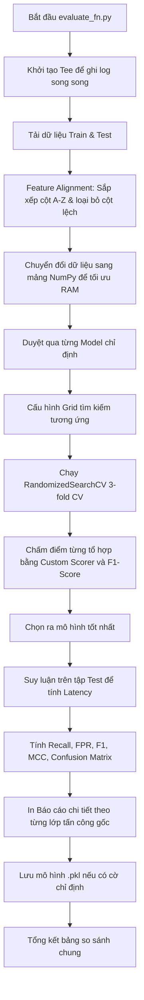

# Báo Cáo Chi Tiết Script: `src/evaluate_fn.py`

## 1. Thông Tin Chung
- **Tên script**: [evaluate_fn.py](file:///c:/IDPS/src/evaluate_fn.py)
- **Mục tiêu**: Đánh giá, so sánh và tìm kiếm siêu tham số tối ưu cho các mô hình học máy phân loại nhị phân (BENIGN vs ATTACK). Ưu tiên tối đa hóa khả năng phát hiện tấn công (Recall / Detection Rate) đồng thời kiểm soát nghiêm ngặt tỷ lệ báo động giả (False Positive Rate - FPR).

---

## 2. Chức Năng Chính
`evaluate_fn.py` cung cấp môi trường thử nghiệm và đánh giá chất lượng mô hình ở mức độ sâu trước khi đưa vào triển khai thực tế:
- **Đánh giá đa thuật toán**: Hỗ trợ huấn luyện và đánh giá đồng thời 3 thuật toán phổ biến trong phát hiện xâm nhập: RandomForest, XGBoost và LightGBM.
- **Tối ưu hóa siêu tham số (Tuning)**: Sử dụng tìm kiếm ngẫu nhiên `RandomizedSearchCV` kết hợp kiểm chéo 3-fold StratifiedKFold để tìm ra tổ hợp tham số tốt nhất.
- **Độ đo tùy chỉnh chuyên biệt (Custom Metric)**: Định nghĩa hàm chấm điểm riêng biệt phạt nặng lỗi báo động giả để tìm ra mô hình cân bằng tốt nhất giữa việc bắt tấn công và bảo vệ lưu lượng bình thường.
- **Phân tích chi tiết theo loại tấn công (Per-Attack-Class Report)**: Không chỉ dừng lại ở chỉ số nhị phân chung, script bóc tách chi tiết khả năng phát hiện của mô hình đối với từng loại tấn công cụ thể trong dữ liệu (ví dụ: PortScan, DoS, Web Attack, Botnet).
- **Đo lường độ trễ (Latency Measurement)**: Tính toán thời gian suy luận trung bình trên mỗi gói tin (micro-giây / packet) để đánh giá khả năng đáp ứng thời gian thực của mô hình.

---

## 3. Đầu Vào (Input)
- **Tham số dòng lệnh (Command Line Arguments)**:
  - `--train_path` (str): Đường dẫn file CSV tập huấn luyện đã tiền xử lý.
  - `--test_path` (str): Đường dẫn file CSV tập kiểm thử đã tiền xử lý.
  - `--models` (list): Danh sách các mô hình cần thử nghiệm (mặc định: `RandomForest`, `XGBoost`, `LightGBM`).
  - `--n_iter` (int): Số tổ hợp tham số sẽ chạy thử ngẫu nhiên (mặc định: 10).
  - `--n_jobs` (int): Số CPU core được sử dụng để chạy song song (mặc định: 1).
  - `--sample_train` (float): Tỉ lệ lấy mẫu từ tập Train để chạy nhanh khi test hệ thống (mặc định: 1.0 - dùng toàn bộ).
  - `--save_model` (cờ): Nếu bật, lưu mô hình tốt nhất ra file `.pkl`.
  - `--output` (str): File lưu toàn bộ kết quả log (mặc định: `f:/IDPS/results/result_evaluate_fn.txt`).

---

## 4. Đầu Ra (Output)
- **Tệp báo cáo tổng hợp**: Lưu toàn bộ lịch sử in ra terminal vào file `.txt` được chỉ định qua `--output`.
- **Bảng so sánh hiệu năng**: So sánh trực tiếp các mô hình dựa trên các tiêu chí: Recall (DR), FPR, Precision, F1-Score, MCC, và Latency (µs).
- **Confusion Matrix và Classification Report**: Chi tiết kết quả dự đoán của từng mô hình trên tập kiểm thử 20%.
- **File nhị phân mô hình (tùy chọn)**: File `best_eval_[tên_model].pkl` chứa pipeline mô hình tốt nhất (bao gồm cả StandardScaler).

---

## 5. Cơ Chế Hoạt Động

### 5.1 Quy trình Tìm kiếm Siêu tham số & Đánh giá

### 5.2 Các kỹ thuật cốt lõi trong script

1. **Ghi log song song (`Tee`)**:
   Để đảm bảo toàn bộ thông tin huấn luyện được lưu giữ mà không cản trở việc theo dõi thời gian thực, script định nghĩa class `Tee` ghi đè đối tượng `sys.stdout`. Mọi lệnh `print` sẽ được chuyển hướng ghi đồng thời lên Terminal và file log kết quả.

2. **Hàm chấm điểm tùy chỉnh (`custom_recall_priority_scorer`)**:
   Trong hệ thống IDPS, việc bỏ sót một cuộc tấn công nguy hiểm hơn nhiều so với việc cảnh báo nhầm một luồng bình thường. Tuy nhiên, nếu cảnh báo nhầm quá nhiều sẽ làm nghẽn tường lửa. Do đó, script định nghĩa điểm số tối ưu hóa:
   $$\text{Score} = \text{Recall} - 5.0 \times \text{FPR}$$
   Hệ số phạt 5.0 đối với FPR ép thuật toán tìm kiếm tham số phải loại bỏ những mô hình có xu hướng báo động giả tràn lan để đạt Recall cao.

3. **Feature Alignment (Đồng bộ đặc trưng)**:
   Để tránh lỗi kích thước đầu vào khi dự đoán, script thực hiện lọc ra các cột chung giữa tập Train và Test, loại bỏ các cột trùng lặp tên, sắp xếp các cột theo bảng chữ cái A-Z, và ép kiểu về `float32`.

4. **Đánh giá độ trễ mạng (Latency)**:
   Script ghi lại thời điểm bắt đầu và kết thúc của quá trình suy luận trên toàn bộ tập kiểm thử, sau đó tính toán:
   $$\text{Latency (µs/packet)} = \frac{\text{Tổng thời gian suy luận (giây)}}{\text{Tổng số gói tin tập Test}} \times 1,000,000$$
   Chỉ số này giúp đánh giá trực tiếp khả năng chịu tải của mô hình khi triển khai inline trên đường truyền tốc độ cao.
