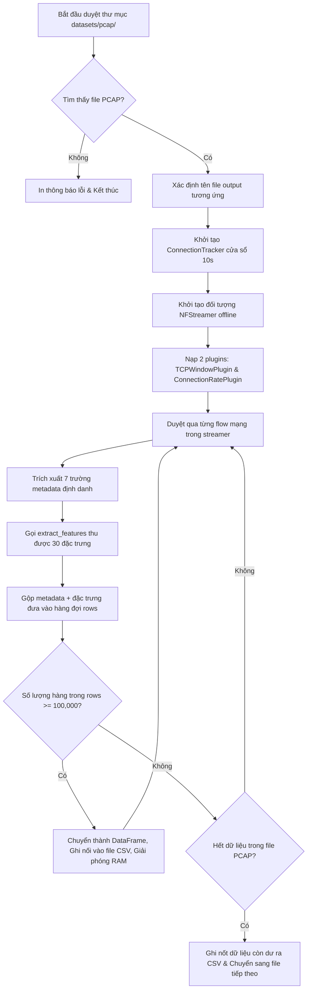

# Báo Cáo Chi Tiết Script: `src/extract_pcap_features.py`

## 1. Thông Tin Chung
- **Tên script**: [extract_pcap_features.py](file:///c:/IDPS/src/extract_pcap_features.py)
- **Mục tiêu**: Trích xuất ngoại tuyến (offline) các đặc trưng mạng từ các tệp tin lưu trữ gói tin mạng thô (.pcap) của bộ dữ liệu CIC-IDS-2017. Đảm bảo 30 đặc trưng mạng trích xuất hoàn toàn đồng nhất với các đặc trưng trích xuất thời gian thực phục vụ huấn luyện mô hình.

---

## 2. Chức Năng Chính
`extract_pcap_features.py` đóng vai trò là điểm bắt đầu của quy trình xây dựng lại dữ liệu huấn luyện (Pipeline Re-building):
- **Trích xuất đặc trưng quy chuẩn**: Chuyển đổi dữ liệu gói tin thô cấp thấp từ file PCAP sang các bản ghi luồng mạng (flows) hai chiều chứa đúng 30 đặc trưng toán học và thống kê của CIC-IDS-2017.
- **Đồng bộ hóa môi trường (Parity Guarantee)**: Sử dụng chính các hàm trích xuất và plugin tùy chỉnh của module realtime (`realtime_extractor.py`) để trích xuất offline. Điều này triệt tiêu hoàn toàn sự sai lệch về phân phối đặc trưng (Distribution Gap) giữa lúc huấn luyện mô hình và lúc chạy phòng thủ thực tế.
- **Tiết kiệm tài nguyên đĩa và RAM (Chunk Saving)**: Xử lý lần lượt từng file PCAP lớn (tổng quy mô ~50GB) bằng cách phân tích và ghi dữ liệu ra CSV theo từng khối (chunk) 100.000 dòng. Giảm tải tối đa cho bộ nhớ RAM của hệ thống và giải phóng tài nguyên liên tục.

---

## 3. Đầu Vào (Input)
- **Các tệp tin gói tin mạng thô**:
  - Tất cả các file PCAP nằm trong thư mục `datasets/pcap/` (bao gồm Monday.pcap, Tuesday.pcap, Wednesday.pcap, Thursday.pcap, Friday.pcap).

---

## 4. Đầu Ra (Output)
- **Các tệp tin đặc trưng chưa gán nhãn**:
  - Lưu tại `datasets/nfs_csv/[tên_ngày]_unlabeled.csv` (ví dụ: `Monday_unlabeled.csv`, `Tuesday_unlabeled.csv`).
  - Cấu trúc cột của CSV đầu ra bao gồm 37 cột:
    - **7 cột metadata định danh**: `src_ip`, `dst_ip`, `src_port`, `dst_port`, `protocol`, `bidirectional_first_seen_ms`, `bidirectional_last_seen_ms` (dùng để đối chiếu gán nhãn).
    - **30 cột đặc trưng mạng**: Từ `ACK Flag Count` đến `Total Length of Fwd Packets` (phục vụ huấn luyện mô hình).

---

## 5. Cơ Chế Hoạt Động

### 5.1 Quy trình trích xuất đặc trưng ngoại tuyến

### 5.2 Cơ chế thực thi chi tiết

1. **Khởi tạo NFStreamer offline**:
   Để trích xuất dữ liệu từ tệp tin đã lưu thay vì card mạng sống, script truyền đường dẫn tệp tin PCAP vào tham số `source` của `NFStreamer`. Cấu hình timeouts được đồng bộ hoàn toàn với module realtime:
   - `idle_timeout = 10` giây.
   - `active_timeout = 30` giây.
   - Bật phân tích thống kê `statistical_analysis = True`.

2. **Tích hợp các Plugin nâng cao**:
   Tương tự như lúc bắt gói tin trực tiếp, NFStreamer được nạp thêm 2 plugin:
   - `TCPWindowPlugin`: Trích xuất kích thước cửa sổ TCP ban đầu (chiều thuận và nghịch).
   - `ConnectionRatePlugin` (kết hợp với `ConnectionTracker` nội bộ): Đo lường mật độ kết nối trên cổng đích trong cửa sổ trượt 10 giây.

3. **Ghi dữ liệu luồng trượt theo khối (Chunk-based saving)**:
   Mỗi file PCAP của CIC-IDS-2017 có kích thước rất lớn. Nếu giữ toàn bộ dữ liệu trích xuất trên RAM rồi mới ghi ra đĩa, script sẽ bị hệ điều hành tắt do tràn bộ nhớ (Out-Of-Memory).
   Để xử lý điều này:
   - Một danh sách tạm `rows` chứa các bản ghi được tích lũy.
   - Khi `len(rows)` đạt ngưỡng `chunk_size = 100,000`, script chuyển đổi nó thành `pd.DataFrame` kèm tên cột đầy đủ.
   - Gọi hàm `to_csv` với chế độ nối tiếp `mode='a'` (nếu file đã có dữ liệu) hoặc tạo mới `mode='w'` (cho chunk đầu tiên) để lưu xuống đĩa.
   - Giải phóng vùng nhớ và gọi `gc.collect()` lập tức để thu hồi RAM.
