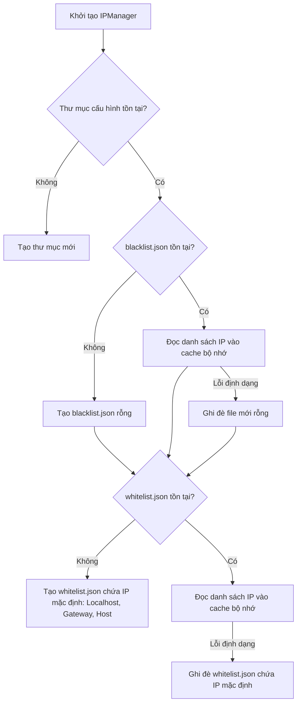

# Báo Cáo Chi Tiết Script: `src/ip_manager.py`

## 1. Thông Tin Chung
- **Tên script**: [ip_manager.py](file:///c:/IDPS/src/ip_manager.py)
- **Class chính**: `IPManager`
- **Mục tiêu**: Quản lý và lưu trữ danh sách trắng (Whitelist) và danh sách đen (Blacklist) các địa chỉ IP. Cung cấp cơ chế tra cứu siêu nhanh và lưu trữ bền vững (Persistence) dưới dạng tệp JSON.

---

## 2. Chức Năng Chính
`IPManager` đóng vai trò là cơ sở dữ liệu kiểm soát truy cập cục bộ của hệ thống IDPS:
- **Tra cứu tốc độ cao (O(1) Lookup)**: Sử dụng cấu trúc dữ liệu `set` trong bộ nhớ RAM để thực hiện kiểm tra IP nguồn của mỗi luồng mạng (flow) đi qua với thời gian phản hồi gần như bằng không. Điều này cực kỳ quan trọng đối với hệ thống phòng thủ thời gian thực.
- **An toàn đa luồng (Thread-safety)**: Đồng bộ hóa các thao tác đọc/ghi bằng khóa loại trừ tương hỗ (`threading.Lock`). Nhờ đó, luồng chính của daemon thu thập lưu lượng và các luồng phụ (như tiến trình tương quan sự kiện hoặc API quản trị) có thể truy cập danh sách IP cùng lúc mà không gây ra lỗi tranh chấp tài nguyên (race conditions).
- **Lưu trữ bền vững (JSON Persistence)**: Đồng bộ tức thì bất kỳ thay đổi nào (thêm/xóa IP) từ bộ nhớ RAM xuống file JSON trên ổ đĩa. Đảm bảo dữ liệu danh sách đen/trắng không bị mất khi hệ thống hoặc container bị khởi động lại.
- **Khởi tạo thông minh**: Tự động tạo cấu trúc file mặc định và điền các IP hệ thống thiết yếu vào whitelist nếu các file cấu hình chưa tồn tại hoặc bị lỗi.

---

## 3. Đầu Vào (Input)
- **Tham số khởi tạo**:
  - `config_dir` (str): Đường dẫn đến thư mục chứa cấu hình (mặc định: `/app/configs`).
- **Tệp tin cấu hình trên ổ đĩa**:
  - `/app/configs/blacklist.json`: Chứa danh sách các IP đang bị chặn.
  - `/app/configs/whitelist.json`: Chứa danh sách các IP đáng tin cậy.
- **Tham số đầu vào của API**:
  - `ip` (str): Địa chỉ IP cần tra cứu, thêm hoặc xóa khỏi danh sách.

---

## 4. Đầu Xuất (Output)
- **Tệp tin JSON lưu trên ổ đĩa**:
  - `blacklist.json` và `whitelist.json` được cập nhật định dạng thụt lề (`indent=4`) và sắp xếp theo thứ tự bảng chữ cái để thuận tiện cho việc chỉnh sửa thủ công của quản trị viên.
- **Trạng thái bộ nhớ**:
  - Cập nhật các tập hợp cục bộ `self._blacklist` và `self._whitelist`.
- **Nhật ký hoạt động (Logs)**: Ghi lại thông tin qua logger `Autodefense.IPManager`:
  - `Loaded blacklist: X IPs` / `Loaded whitelist: Y IPs` khi khởi chạy thành công.
  - `Đã thêm/xóa IP [ip] vào/khỏi Blacklist/Whitelist`.
  - Các lỗi định dạng tệp hoặc lỗi ghi đĩa hệ thống.

---

## 5. Cơ Chế Hoạt Động

### 5.1 Quy trình Khởi động và Đọc cấu hình (`_load`)



### 5.2 Cơ chế thực thi an toàn luồng

Mọi phương thức công khai của `IPManager` đều được bọc trong ngữ cảnh quản lý khóa `with self._lock:`. Cơ chế này đảm bảo rằng tại một thời điểm chỉ có duy nhất một luồng có quyền thay đổi hoặc đọc dữ liệu từ cache bộ nhớ:

```python
def is_blacklisted(self, ip: str) -> bool:
    with self._lock:  # Bắt đầu khóa độc quyền
        return ip in self._blacklist  # Tra cứu O(1)
                      # Tự động giải phóng khóa khi kết thúc block
```

### 5.3 Thao tác cập nhật dữ liệu (Ví dụ: `add_to_blacklist`)

Khi có yêu cầu thêm một địa chỉ IP (ví dụ: `192.168.226.130`) vào danh sách đen:
1. Luồng gọi phương thức sẽ chiếm hữu khóa `self._lock`.
2. Kiểm tra xem IP đó đã tồn tại trong `self._blacklist` (cache bộ nhớ) chưa. Nếu có, lập tức giải phóng khóa và trả về `False` (bỏ qua ghi đĩa không cần thiết).
3. Nếu IP chưa có, thêm IP đó vào tập hợp `self._blacklist`.
4. Gọi hàm nội bộ `_save_blacklist()`:
   - Chuyển đổi tập hợp `self._blacklist` thành danh sách đã sắp xếp (`sorted(list(...))`).
   - Tạo cấu trúc dữ liệu JSON kèm trường mô tả:
     ```json
     {
         "description": "IP Blacklist - Auto-blocked by IDPS ML detection + manual entries",
         "ips": ["192.168.226.130"]
     }
     ```
   - Ghi đè nội dung JSON này lên tệp `/app/configs/blacklist.json` bằng chế độ ghi đè file thông thường.
5. Ghi log cảnh báo mức INFO và trả về `True`.
