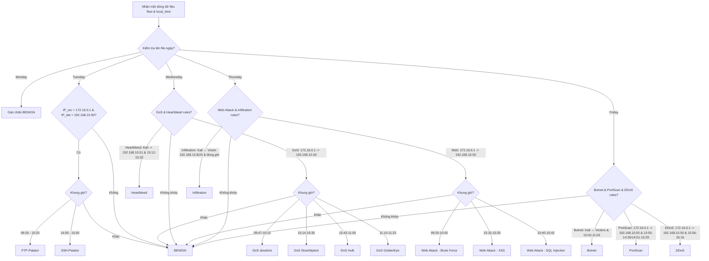

# Báo Báo Chi Tiết Script: `src/label_flows.py`

## 1. Thông Tin Chung
- **Tên script**: [label_flows.py](file:///c:/IDPS/src/label_flows.py)
- **Mục tiêu**: Thực hiện gán nhãn (Labeling) tự động cho các bản ghi luồng mạng (flows) đã được trích xuất đặc trưng thô. Ánh xạ chính xác các sự kiện tấn công dựa trên lịch trình tấn công thực tế và địa chỉ IP của các máy tham gia trong bộ dữ liệu CIC-IDS-2017.

---

## 2. Chức Năng Chính
`label_flows.py` là giai đoạn trung gian quan trọng nhằm chuyển đổi dữ liệu thô không nhãn thành tập dữ liệu có giám sát (Supervised Dataset):
- **Ánh xạ lịch trình tấn công chính xác**: Sử dụng các quy tắc về thời gian, địa chỉ IP nguồn/đích của kẻ tấn công và nạn nhân để xác định chính xác luồng mạng nào là lành tính (`BENIGN`) và luồng mạng nào thuộc loại hình tấn công cụ thể nào.
- **Xử lý đồng bộ múi giờ (Timezone Alignment)**: Giải quyết vấn đề lệch múi giờ giữa thời gian ghi nhận trong file PCAP (lưu dưới dạng UTC bởi NFStream) và thời gian ghi trong lịch trình tấn công gốc của bộ dữ liệu (ghi theo giờ địa phương AST/ADT tại Canada).
- **Hợp nhất dữ liệu (Dataset Consolidation)**: Đọc lần lượt dữ liệu chưa gán nhãn của 5 ngày làm việc (từ Thứ Hai đến Thứ Sáu), thực hiện gán nhãn và gộp tất cả các ngày lại thành một tệp tin CSV duy nhất chứa toàn bộ dữ liệu huấn luyện của tuần.
- **Hỗ trợ gỡ lỗi trực quan**: In ra màn hình số lượng và loại hình tấn công phát hiện được sau mỗi khối dữ liệu xử lý để hỗ trợ người dùng kiểm tra cấu hình múi giờ.

---

## 3. Đầu Vào (Input)
- **Các tệp tin CSV đặc trưng thô chưa gán nhãn**:
  - Các file nằm trong thư mục `datasets/nfs_csv/*_unlabeled.csv` (Monday_unlabeled.csv đến Friday_unlabeled.csv).
- **Lịch trình tấn công gốc**: Các khung giờ tấn công và địa chỉ IP tương ứng theo tài liệu mô tả CIC-IDS-2017.

---

## 4. Đầu Ra (Output)
- **Tập dữ liệu đã gán nhãn tích hợp**:
  - File `datasets/cic2017_nfs_labeled.csv` chứa toàn bộ dữ liệu của cả tuần đã được gán nhãn đầy đủ.
  - Thêm cột `Label` ở cuối bảng dữ liệu, chứa các nhãn cụ thể: `BENIGN`, `FTP-Patator`, `SSH-Patator`, `DoS slowloris`, `DoS Slowhttptest`, `DoS Hulk`, `DoS GoldenEye`, `Heartbleed`, `Web Attack – Brute Force`, `Web Attack – XSS`, `Web Attack – Sql Injection`, `Infiltration`, `Botnet`, `PortScan`, `DDoS`.

---

## 5. Cơ Chế Hoạt Động

### 5.1 Giải quyết lệch múi giờ (Timezone Offset)

Các file PCAP lưu trữ timestamp của các luồng mạng dưới dạng mili-giây UTC. Tuy nhiên lịch trình tấn công thực tế của CIC-IDS-2017 được ghi nhận theo giờ Atlantic Daylight Time (ADT - UTC-3) của Canada vào mùa hè (tháng 7/2017).

Để đối chiếu chính xác, script thực hiện chuyển đổi như sau:
1. Lấy thuộc tính thời gian bắt đầu luồng mạng: `bidirectional_first_seen_ms`.
2. Chuyển đổi mili-giây sang đối tượng Datetime định dạng UTC:
   ```python
   dt_utc = datetime.datetime.fromtimestamp(ms / 1000.0, tz=datetime.timezone.utc)
   ```
3. Cộng thêm độ lệch múi giờ chỉ định (biến `TIMEZONE_OFFSET_HOURS = -3`):
   ```python
   dt_local = dt_utc + datetime.timedelta(hours=TIMEZONE_OFFSET_HOURS)
   ```
4. Trích xuất lấy đối tượng `time` (giờ, phút, giây) của múi giờ địa phương để so khớp với khung giờ tấn công:
   ```python
   t = dt_local.time()
   ```

### 5.2 Sơ đồ logic gán nhãn theo quy tắc ngày



### 5.3 Xử lý theo chunk để tối ưu đĩa

Do file CSV tổng hợp sau khi gộp 5 ngày có dung lượng rất lớn (chứa hàng triệu dòng dữ liệu), script sử dụng hàm `pd.read_csv` kết hợp với tham số `chunksize = 200,000` để chia nhỏ quá trình đọc file.
Mỗi chunk sau khi được gán nhãn qua phương thức `apply` sẽ ngay lập tức được ghi lưu nối tiếp vào file đích `cic2017_nfs_labeled.csv`. File output được thiết lập `header=True` ở lần ghi đầu tiên và các lần sau chỉ ghi dữ liệu (`header=False`, `mode='a'`).
