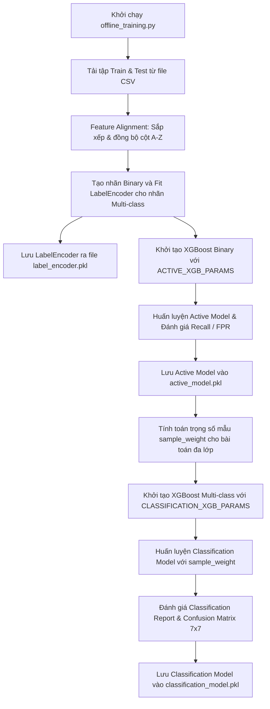

# Báo Cáo Chi Tiết Script: `src/offline_training.py`

## 1. Thông Tin Chung
- **Tên script**: [offline_training.py](file:///c:/IDPS/src/offline_training.py)
- **Mục tiêu**: Huấn luyện và đóng gói (serialize) hai mô hình XGBoost cốt lõi của hệ thống Zero-Touch IDPS theo kiến trúc phân tầng (2-tier Architecture). Tạo ra các tệp tin mô hình sẵn sàng cho việc triển khai suy luận thời gian thực (Real-time Inference).

---

## 2. Chức Năng Chính
`offline_training.py` là nền tảng cốt lõi thiết lập nên "trí tuệ nhân tạo" của hệ thống IDPS:
- **Xây dựng kiến trúc phòng thủ 2 tầng**:
  - **Tầng 1 (Active Model - Binary Classifier)**: Huấn luyện mô hình phân loại nhị phân chịu trách nhiệm đưa ra quyết định nhanh chóng là chặn (Block / DROP) hay cho qua (Pass) lưu lượng mạng.
  - **Tầng 2 (Classification Model - Multi-class Classifier)**: Huấn luyện mô hình phân loại 7 lớp để chỉ ra chi tiết loại tấn công đang diễn ra (phục vụ mục đích ghi log cảnh báo chi tiết và hiển thị dashboard).
- **Cân bằng trọng số mẫu huấn luyện (Class Weighting)**: Do dữ liệu đa lớp bị mất cân bằng trầm trọng, script tính toán và áp dụng trọng số mẫu (`sample_weight`) tỷ lệ nghịch với tần suất xuất hiện của lớp để đảm bảo XGBoost học tốt các lớp hiếm mà không cần tăng dung lượng dữ liệu quá nhiều.
- **Tối ưu hiệu năng huấn luyện**: Sử dụng phương thức xây dựng cây `tree_method: 'hist'` giúp XGBoost xử lý cực nhanh trên tập dữ liệu hàng triệu dòng với lượng tiêu thụ RAM tối thiểu.
- **Đóng gói mô hình**: Xuất ra các file `.pkl` đã được nén cấu trúc cây để tải nhanh khi chạy daemon.

---

## 3. Đầu Vào (Input)
- **Dữ liệu huấn luyện và kiểm thử đã tiền xử lý**:
  - `datasets/cic2017_train_80_preprocessed.csv`: Dữ liệu Train (đã SMOTE và gom nhóm nhãn).
  - `datasets/cic2017_test_20_preprocessed.csv`: Dữ liệu Test (đã gom nhóm nhãn).

---

## 4. Đầu Ra (Output)
- **Các file mô hình đóng gói (nén ở mức độ 3)**:
  - `models/active_model.pkl`: Mô hình XGBoost nhị phân đã huấn luyện.
  - `models/classification_model.pkl`: Mô hình XGBoost đa lớp đã huấn luyện.
  - `models/label_encoder.pkl`: File lưu đối tượng `LabelEncoder` dùng để giải mã ngược chỉ số dự đoán thành tên loại tấn công dạng chữ.
- **Đánh giá kiểm thử trực tiếp**: Hiển thị bảng Confusion Matrix nhị phân, tỷ lệ lỗi FPR/FNR, Classification Report đa lớp, và bảng Confusion Matrix 7x7 trên terminal.

---

## 5. Cơ Chế Hoạt Động

### 5.1 Sơ đồ Quy trình Huấn luyện



### 5.2 Cơ chế giải quyết mất cân bằng lớp ở Tầng 2

Đối với mô hình phân loại đa lớp (Tầng 2), mặc dù dữ liệu Train đã qua bước SMOTE nâng mẫu ở file `data_preprocessing.py`, nhưng sự chênh lệch số lượng mẫu giữa lớp `BENIGN` (rất lớn) và các lớp tấn công khác vẫn còn đáng kể. 
Để tối ưu hóa, script áp dụng hàm `compute_sample_weight` của thư viện Scikit-Learn:
```python
sample_weights = compute_sample_weight(class_weight='balanced', y=y_mul_train)
```
Trọng số của mẫu thuộc lớp $c$ được tính theo công thức:
$$W_c = \frac{N_{\text{samples}}}{N_{\text{classes}} \times N_c}$$
Trong đó $N_{\text{samples}}$ là tổng số mẫu, $N_{\text{classes}}$ là số lượng lớp (7), và $N_c$ là số mẫu của lớp $c$. Trọng số này được truyền vào tham số `sample_weight` khi gọi hàm `fit` của XGBoost. Kết quả là mô hình sẽ bị phạt nặng hơn khi dự đoán sai các mẫu thuộc lớp thiểu số, giúp tăng mạnh chỉ số Recall của các lớp tấn công khó phát hiện.

### 5.3 Cấu hình siêu tham số tối ưu (Hyperparameters)

Mô hình được huấn luyện bằng thuật toán XGBoost với các cấu hình tối ưu hóa phần cứng và độ chính xác:
- **Active Model (Binary)**: Sử dụng hàm lỗi `binary:logistic`, học nhanh với `learning_rate: 0.2`, số lượng cây `n_estimators: 200`, độ sâu tối đa cây `max_depth: 8`.
- **Classification Model (Multi-class)**: Sử dụng hàm lỗi `multi:softprob` (dự đoán xác suất phân phối của cả 7 lớp), học chậm và kỹ hơn với `learning_rate: 0.05`, số lượng cây nhiều hơn `n_estimators: 300`, độ sâu tối đa cây `max_depth: 8`.
- Cả hai mô hình đều bật `tree_method: 'hist'` giúp XGBoost tự động phân nhóm các đặc trưng liên tục vào các giỏ (bins) giá trị cố định, tăng tốc độ tính toán điểm chia nhánh lên gấp nhiều lần.
- Đóng gói bằng `joblib.dump(..., compress=3)` để nén dữ liệu mô hình, giảm dung lượng lưu trữ trên đĩa xuống dưới 10MB mỗi file mà không làm ảnh hưởng đến tốc độ load mô hình khi khởi động daemon.
