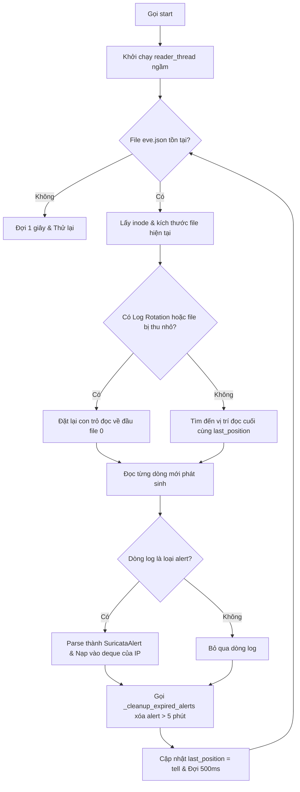

# Báo Cáo Chi Tiết Script: `src/suricata_correlator.py`

## 1. Thông Tin Chung
- **Tên script**: [suricata_correlator.py](file:///c:/IDPS/src/suricata_correlator.py)
- **Các class chính**: `SuricataAlert`, `SuricataCorrelator`
- **Mục tiêu**: Thiết lập công cụ tương quan sự kiện (Correlation Engine) thời gian thực. Kết hợp các cảnh báo chữ ký (Signature-based) từ hệ thống phát hiện xâm nhập truyền thống Suricata với các dự đoán hành vi từ mô hình Machine Learning để nâng cao độ tin cậy quyết định và giảm thiểu báo động giả.

---

## 2. Chức Năng Chính
`suricata_correlator.py` là cầu nối giữa bảo mật truyền thống và trí tuệ nhân tạo:
- **Theo dõi log Suricata thời gian thực (Real-time Tailing)**: Chạy một tiến trình ngầm (background thread) liên tục giám sát và đọc nối tiếp file nhật ký EVE JSON của Suricata nhằm nắm bắt tức thì các cảnh báo mạng.
- **Tính toán điểm rủi ro tương quan (Correlation Scoring)**:
  - **Tái phạm (Repeat Offender)**: Phát hiện và cộng điểm cảnh báo đối với các IP liên tục kích hoạt nhiều signature trong khoảng thời gian ngắn.
  - **Xác xác nhận chéo (Cross-Confirmation)**: Tăng mạnh điểm tin cậy nếu cả ML và Suricata đều phát hiện cùng một loại tấn công trên cùng một IP nguồn.
  - **Tấn công đa hình thái (Polymorphic Attack)**: Cảnh báo nguy hiểm cao độ nếu cùng một IP nguồn nhưng ML nhận diện một kiểu tấn công và Suricata cảnh báo một kiểu tấn công khác (cho thấy kẻ tấn công đang thay đổi phương thức xâm nhập).
- **Điều chỉnh trọng số theo mức độ nghiêm trọng (Severity Weighting)**: Áp dụng hệ số nhân để giảm thiểu ảnh hưởng của các cảnh báo nhiễu cấp thấp (như ET Open Info/Policy alerts) và nâng cao cảnh báo nghiêm trọng.
- **Cơ chế ghi đè luật chặn (L7 Drop Override)**: Nếu phát hiện một luật chặn đặc biệt ở mức ứng dụng của Suricata (lu luật L7 Drop), script sẽ kích hoạt cơ chế ghi đè quyết định ML để chèn luật chặn tường lửa ngay lập tức.
- **Quản lý bộ nhớ đệm tự động (TTL Cleanup)**: Tự động loại bỏ các cảnh báo đã quá thời gian lưu giữ (mặc định: 5 phút) ra khỏi RAM để duy trì dung lượng bộ nhớ ổn định.

---

## 3. Đầu Vào (Input)
- **Tệp nhật ký Suricata**: File `/app/logs/suricata/eve.json` ghi nhận các sự kiện cảnh báo dưới dạng JSON của Suricata.
- **Đầu vào truy vấn API tương quan (`correlate`)**:
  - `src_ip` (str): IP nguồn của luồng mạng hiện tại.
  - `dst_port` (int): Cổng đích của luồng mạng.
  - `ml_attack_type` (str): Loại tấn công được nhận diện bởi mô hình ML.
  - `ml_confidence` (float): Độ tin cậy dự đoán của mô hình ML.

---

## 4. Đầu Ra (Output)
- **Thông số điểm rủi ro**: Trả về điểm tương quan `correlation_score` (giá trị float từ 0.0 đến 0.90) để cộng thêm vào độ tin cậy của ML.
- **Chi tiết tương quan**: Trả về dictionary `details` chứa:
  - `suricata_alerts_count` (int): Số lượng cảnh báo của IP này trong 5 phút qua.
  - `suricata_action_drop` (bool): Có cảnh báo DROP nào từ các luật L7 của Suricata hay không (để thực hiện override chặn ngay).
  - `matched_signatures` (list): Danh sách các chữ ký Suricata khớp với loại tấn công của ML.
  - Các cờ trạng thái (`repeat_offender`, `different_attack_types`, `suricata_only_detection`).

---

## 5. Cơ Chế Hoạt Động

### 5.1 Luồng đọc log ngầm và Cơ chế Log Rotation

### 5.2 Giải thuật chấm điểm tương quan chi tiết

Khi hàm `correlate` được gọi cho một IP nguồn:
1. **Khóa tài nguyên (`self._lock`)**: Đảm bảo đồng bộ hóa luồng đọc log và luồng truy vấn điểm tương quan để tránh lỗi truy xuất.
2. **Lọc và phân nhóm**: Đọc danh sách alert trong 5 phút gần nhất của IP đó.
3. **Tính toán điểm nền (Base score)**:
   - Nếu mô hình ML đánh giá luồng mạng là an toàn (`ml_attack_type` rỗng): Chuyển sang nhánh **Suricata-only**. Điểm cộng tích lũy nhẹ $+0.10$ cho mỗi loại tấn công duy nhất phát hiện từ signature. Tổng điểm tương quan nhánh này bị giới hạn cứng bởi `suricata_only_max_score` (mặc định: 0.30) nhằm ngăn chặn các cảnh báo nhiễu cấp thấp tự động block IP.
   - Nếu mô hình ML đánh giá là Tấn công:
     - Khớp signature: Nếu Suricata alert và ML dự đoán cùng loại tấn công, cộng thêm $+0.20$ điểm (Xác nhận hành vi).
     - Lệch signature: Nếu Suricata alert chỉ ra loại tấn công khác với ML, cộng thêm $+0.30$ điểm (Cảnh báo đa hình thái).
     - Tái phạm: Cộng thêm $+0.05$ (nếu có 2 alert) hoặc $+0.15$ (nếu có $\ge 3$ alert).
4. **Xử lý luật chặn L7**: Nếu bất kỳ alert nào chứa hành động chặn cứng (`action` là drop, blocked, hoặc reject), thiết lập cờ `suricata_action_drop = True` và cộng thêm $+0.50$ vào điểm tương quan.
5. **Nhân hệ số nghiêm trọng (Severity Boost)**:
   Tìm mức độ nghiêm trọng lớn nhất trong các cảnh báo thu thập được:
   - Severity 1 (Cảnh báo thông tin - Info): Hệ số $0.30$.
   - Severity 2 (Cảnh báo nhẹ - Warning): Hệ số $0.50$.
   - Severity 3 (Cảnh báo trung bình - Notice): Hệ số $0.70$.
   - Severity 4 (Cảnh báo nghiêm trọng - Critical): Hệ số $0.85$.
   
   Điểm tương quan cuối cùng sẽ được nhân với hệ số nghiêm trọng này:
   $$\text{Final Correlation Score} = \text{Accumulated Score} \times \text{Severity Weight}$$
   *Ý nghĩa*: Một IP dù có bị nhiều alert cấp thấp (severity 1 - Info) kích hoạt, điểm rủi ro cuối cùng vẫn rất nhỏ ($Score \times 0.30$) và không thể gây báo động giả. Ngược lại, chỉ cần 1 alert nghiêm trọng (severity 4 - Critical) kích hoạt, điểm rủi ro sẽ được giữ lại gần như nguyên vẹn ($Score \times 0.85$).
6. **Giới hạn điểm cuối (Hard Cap)**:
   - Giới hạn tối đa là `suricata_only_max_score` (0.30) nếu ML đánh giá là lành tính.
   - Giới hạn tối đa là $0.90$ nếu ML đánh giá là tấn công để tối ưu hóa khả năng cộng dồn.
