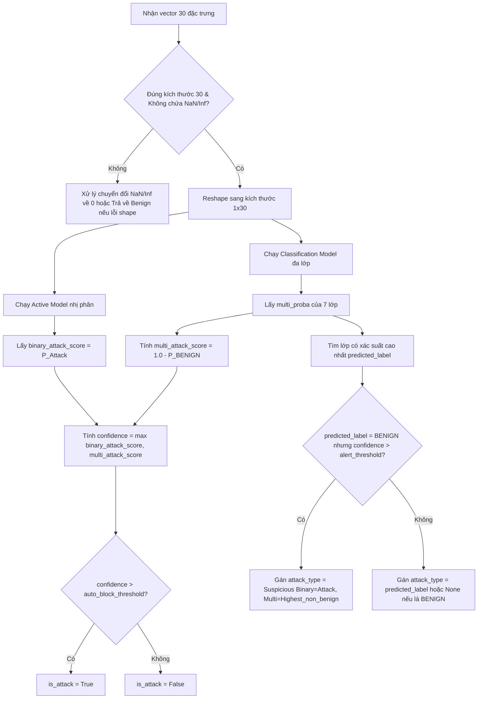

# Báo Cáo Chi Tiết Script: `src/threat_evaluator.py`

## 1. Thông Tin Chung
- **Tên script**: [threat_evaluator.py](file:///c:/IDPS/src/threat_evaluator.py)
- **Class chính**: `ThreatEvaluator`
- **Mục tiêu**: Đóng vai trò là công cụ suy luận (Inference Engine) thời gian thực của hệ thống IDPS. Chịu trách nhiệm nạp các mô hình học máy XGBoost đã huấn luyện và thực hiện dự đoán phân loại mức độ đe dọa từ vector 30 đặc trưng mạng đầu vào.

---

## 2. Chức Năng Chính
`ThreatEvaluator` là trung tâm đưa ra phán quyết về mặt trí tuệ nhân tạo của hệ thống IDPS:
- **Tải mô hình tối ưu (Model Loading)**: Nạp đồng thời Active Model (Binary), Classification Model (Multi-class) và bộ giải mã nhãn (`LabelEncoder`) vào bộ nhớ RAM một lần duy nhất khi khởi động hệ thống để tránh trễ I/O đĩa trong quá trình hoạt động.
- **Suy luận song song đa tầng (Hybrid Inference)**: Chạy đồng thời cả 2 mô hình XGBoost cho mỗi luồng mạng để tận dụng thế mạnh của từng tầng: tầng nhị phân bắt nhanh đe dọa, tầng đa lớp phân loại chi tiết và tính toán xác suất tổng quát.
- **Hợp nhất kết quả (Fusion Logic)**: Kết hợp điểm tin cậy (confidence score) từ cả hai mô hình bằng cách lấy giá trị cực đại nhằm giảm thiểu tối đa tỷ lệ bỏ lọt tấn công (False Negatives).
- **Đọc cấu hình động (Dynamic Thresholds)**: Đọc các ngưỡng chặn (`auto_block_threshold`) và ngưỡng cảnh báo (`alert_threshold`) từ tệp cấu hình JSON giúp người vận hành có thể tùy chỉnh chính sách bảo mật mà không cần chỉnh sửa hay biên dịch lại mã nguồn.
- **Xử lý dữ liệu bất thường (Input Sanitization)**: Tự động phát hiện và thay thế các giá trị vô cực (`Inf`) hoặc giá trị khuyết thiếu (`NaN`) trong luồng mạng thời gian thực để ngăn chặn các lỗi suy luận làm treo hệ thống.

---

## 3. Đầu Vào (Input)
- **Từ file cấu hình trên đĩa**:
  - `configs/thresholds.json`: Chứa các ngưỡng quyết định:
    - `auto_block_threshold` (mặc định: 0.85): Ngưỡng tin cậy tối thiểu để tự động chặn IP.
    - `alert_threshold` (mặc định: 0.60): Ngưỡng tối thiểu để ghi nhận cảnh báo nghi ngờ.
    - `suricata_only_max_score` (mặc định: 0.30): Điểm giới hạn khi không có ML hoặc khi ML đánh giá là lành tính nhưng Suricata có cảnh báo cấp thấp.
- **Từ các file mô hình đã huấn luyện**:
  - `models/active_model.pkl`
  - `models/classification_model.pkl`
  - `models/label_encoder.pkl`
- **Từ API cuộc gọi**:
  - `features` (NumPy array): Vector đặc trưng dạng 1D chứa đúng 30 đặc trưng số của luồng mạng.

---

## 4. Đầu Ra (Output)
Trả về một cấu trúc dữ liệu kiểu `dict` chứa các thông tin sau:
- `is_attack` (bool): Chỉ định IP nguồn của luồng mạng này có cần bị chặn ngay lập tức hay không (`True`/`False`).
- `confidence` (float): Điểm tin cậy đe dọa tổng hợp cuối cùng (giá trị lớn nhất giữa điểm nhị phân và điểm đa lớp).
- `binary_score` (float): Điểm xác suất tấn công từ mô hình nhị phân.
- `multi_score` (float): Điểm xác suất tấn công tổng hợp từ mô hình đa lớp (tính bằng $1.0 - P(BENIGN)$).
- `attack_type` (str | None): Loại tấn công cụ thể được nhận diện (hoặc nhãn `Suspicious...` nếu có nghi ngờ chéo).
- `attack_confidence` (float): Độ tin cậy riêng của lớp tấn công được dự đoán bởi mô hình đa lớp.
- `inference_time_ms` (float): Tổng thời gian thực hiện suy luận (mili-giây).
- `class_probabilities` (dict): Danh sách xác suất của cả 7 lớp phân loại đã được định dạng chuẩn hóa key phục vụ vẽ biểu đồ (ví dụ: thay thế ký tự đặc biệt).

---

## 5. Cơ Chế Hoạt Động

### 5.1 Thuật toán Hợp nhất Quyết định (Decision Fusion)

`ThreatEvaluator` áp dụng chiến thuật kết hợp thông tin đa chiều để đảm bảo tính an toàn cao nhất cho hệ thống mạng:

### 5.2 Cơ chế xử lý mâu thuẫn giữa 2 mô hình (Overlap Resolution)

Có những trường hợp luồng mạng có hành vi bất thường khiến hai mô hình đưa ra kết quả mâu thuẫn: mô hình nhị phân (Active Model) khẳng định là Tấn công (`binary_attack_score > 0.85`), nhưng mô hình đa lớp lại dự đoán lớp có xác suất cao nhất là `BENIGN`.

Để giải quyết vấn đề này:
1. `ThreatEvaluator` tính toán tổng điểm đe dọa của mô hình đa lớp bằng cách lấy phần bù của xác suất lành tính: `multi_attack_score = 1.0 - P("BENIGN")`.
2. Điểm tin cậy cuối cùng là `confidence = max(binary_attack_score, multi_attack_score)`.
3. Nếu xảy ra hiện tượng mâu thuẫn (Mô hình đa lớp chọn `BENIGN` làm nhãn có xác suất lớn nhất nhưng điểm `confidence` nhị phân lại vượt quá ngưỡng cảnh báo `alert_threshold`), hệ thống sẽ **không** bỏ qua. Thay vào đó, nó duyệt qua phân phối xác suất của 6 lớp tấn công còn lại, tìm lớp tấn công có xác suất cao nhất (ví dụ: `DoS/DDoS`) và gán nhãn loại đe dọa là:
   `Suspicious (Binary=Attack, Multi=DoS/DDoS)`
   Cơ chế này giúp quản trị viên dễ dàng nhận diện các biến thể tấn công mới hoặc các trường hợp nghi ngờ cần phân tích sâu hơn.
