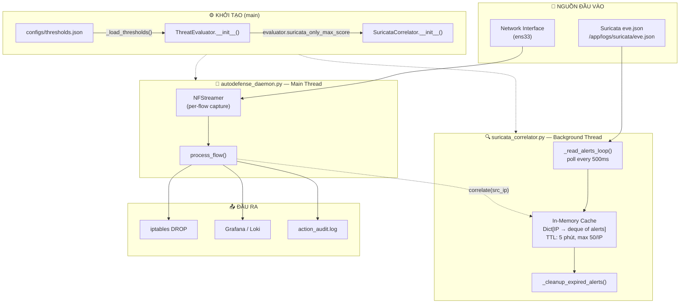
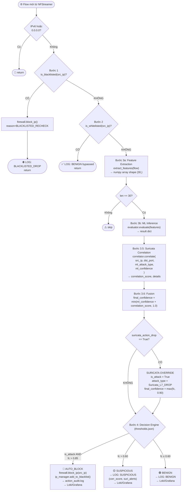
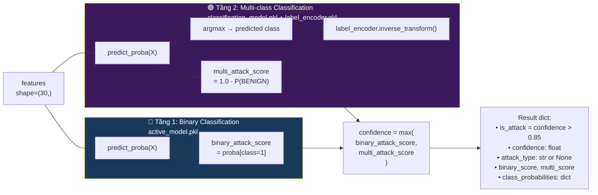
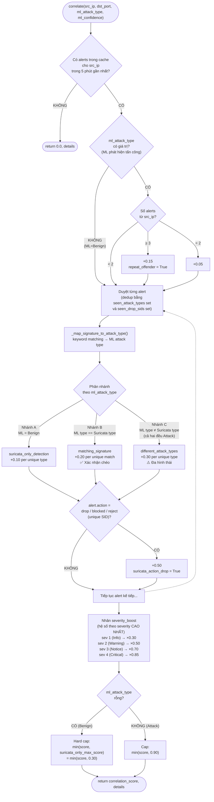
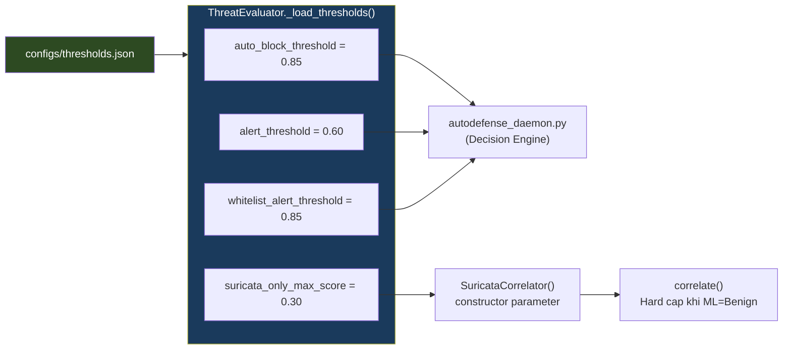
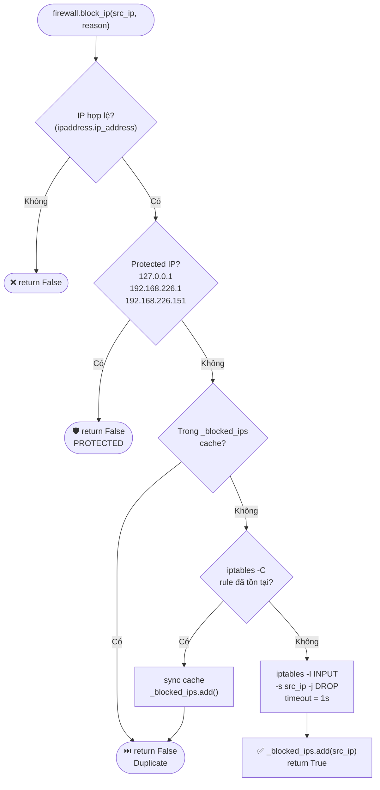
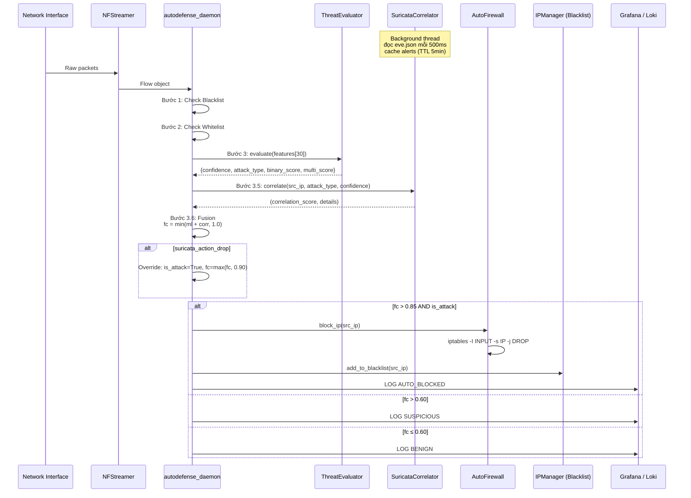

# 🛡️ IDPS System — Workflow Toàn Bộ

> **Cập nhật lần cuối:** 2026-05-28T21:02 ICT  
> **Đồng bộ từ VM:** `dmtien@192.168.226.151`  
> **Source files:** `src/autodefense_daemon.py`, `src/threat_evaluator.py`, `src/suricata_correlator.py`, `src/auto_firewall.py`, `configs/thresholds.json`

---

## 1. Kiến Trúc Tổng Quan

Hệ thống có **3 luồng** hoạt động song song trong Docker container:



---

## 2. Pipeline Xử Lý Chi Tiết (process_flow)



---

## 3. ML Inference — 2 Tầng XGBoost



**7 classes:** `BENIGN` · `Brute Force` · `DoS/DDoS` · `PortScan` · `Web Attack` · `Botnet` · `Exploitation/Rare`

**Edge case:** Multi=BENIGN nhưng Binary cao (> 0.60) → `attack_type = "Suspicious (Binary=Attack, Multi=<highest_non_benign>)"`

---

## 4. Suricata Correlation — Scoring Logic



### Bảng điểm tóm tắt

| Điều kiện | Điểm | Dedup | Ghi chú |
|---|:---:|---|---|
| **Nhánh A** — ML=Benign, Suricata có alert | `+0.10` / loại | `seen_attack_types` | Cap cứng ≤ 0.30 |
| **Nhánh B** — ML type = Suricata type | `+0.20` / loại | `seen_attack_types` | Cross-validation |
| **Nhánh C** — ML type ≠ Suricata type | `+0.30` / loại | `seen_attack_types` | Multi-vector attack |
| **Repeat offender** (≥3 alerts, ML có tín hiệu) | `+0.15` | — | Chỉ khi ML đã phát hiện |
| **Repeat offender** (=2 alerts, ML có tín hiệu) | `+0.05` | — | — |
| **DROP action** (custom L7 rule) | `+0.50` / SID | `seen_drop_sids` | Mỗi signature_id 1 lần |
| **× severity_boost** | ×0.30 ~ ×0.85 | — | Nhân toàn bộ score |

---

## 5. Luồng Đọc Config — `thresholds.json`



### Bảng tham số hiện tại

| Tham số | Giá trị | Dùng bởi | Mục đích |
|---|:---:|---|---|
| `auto_block_threshold` | **0.85** | `ThreatEvaluator` → Decision Engine | `fc > 0.85` → AUTO_BLOCK |
| `alert_threshold` | **0.60** | `ThreatEvaluator` → Decision Engine | `fc > 0.60` → SUSPICIOUS |
| `whitelist_alert_threshold` | **0.85** | `ThreatEvaluator` | Ngưỡng cảnh báo cho whitelist IP |
| `suricata_only_max_score` | **0.30** | `ThreatEvaluator` → `SuricataCorrelator` | Hard cap corr_score khi ML=Benign |

> Tất cả 4 tham số đều **✅ Active** — được đọc từ file và sử dụng trong runtime.

### Vùng quyết định

```
final_confidence = min(ml_confidence + correlation_score, 1.0)

  0.0 ──────────────── 0.60 ──────────────── 0.85 ──── 1.0
   │      🟢 BENIGN      │    🟡 SUSPICIOUS    │  🔴 AUTO_BLOCK │
   │   (không làm gì)    │  (log + Grafana)    │  (iptables DROP │
   │                     │                     │   + Blacklist)  │
```

---

## 6. AutoFirewall — iptables Logic



---

## 7. Timeline Flow — Từ Packet Đến Block



---

## 8. Tóm Tắt Hiện Tại

### ✅ Điểm mạnh
- **2 tầng ML** (Binary + Multi-class) — robust hơn single model
- **Config tập trung** — tất cả thresholds đọc từ `thresholds.json`, không còn dead config
- **Dedup scoring** — `seen_attack_types` + `seen_drop_sids` tránh score inflation
- **Severity multiplier** — ET Info/Policy alerts (sev=1) chỉ có 30% ảnh hưởng
- **Hard cap Benign** — `suricata_only_max_score = 0.30` ngăn ET Open alert tự block
- **Suricata L7 Override** — custom rule DROP → override ML Benign
- **Protected IPs** — không bao giờ block gateway/server

### ⚠️ Điểm cần cải thiện
1. **[Thấp]** Xem xét scenario ML confidence thấp + Suricata DROP mạnh → liệu auto-block có hợp lý không (khi final_confidence > 0.85)
