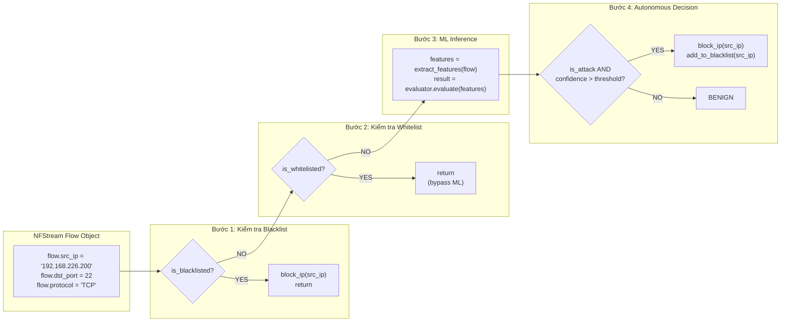
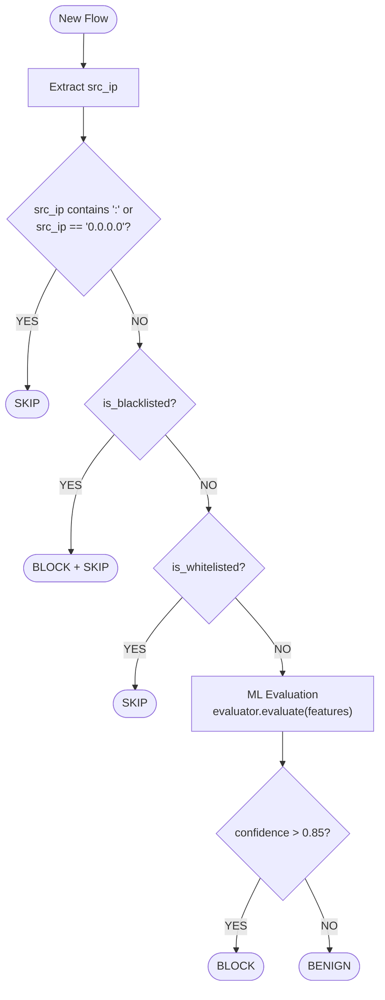

# Báo Cáo Tuần 5

## Zero-Touch IDPS: Auto-Blocking System

**Thời gian:** 08/05/2026 - 14/05/2026  
**Trạng thái:** ✅ Hoàn thành

---

## Mục lục

1. [Yêu cầu Tuần 5](#1-yêu-cầu-tuần-5)
2. [Quá trình Implementation](#2-quá-trình-implementation)
   - [2.1 Extract Attacker's Source IP](#21-extract-attackers-source-ip)
   - [2.2 Automatic Blocking Command Execution](#22-automatic-blocking-command-execution)
3. [Các thư viện sử dụng](#3-các-thư-viện-sử-dụng)
4. [Các hàm và logic](#4-các-hàm-và-logic)
5. [Kết quả thực thi](#5-kết-quả-thực-thi)
6. [Ảnh chụp màn hình](#6-ảnh-chụp-màn-hình)

---

## 1. Yêu cầu Tuần 5

| # | Yêu cầu | Trạng thái |
|---|---------|-----------|
| 1 | Add logic to Python script: extract attacker's source IP | ✅ Hoàn thành |
| 2 | Call OS to execute automatic blocking command | ✅ Hoàn thành |

---

## 2. Quá trình Implementation

### 2.1 Extract Attacker's Source IP

#### 2.1.1 Mục tiêu

Trích xuất địa chỉ IP nguồn (source IP) của kẻ tấn công từ các luồng mạng (network flows) để phục vụ cho việc đánh giá mối đe dọa và thực hiện tự động ngăn chặn.

#### 2.1.2 Module chính

**File:** [`src/autodefense_daemon.py`](src/autodefense_daemon.py:70) - Hàm `process_flow()`

#### 2.1.3 Logic trích xuất Source IP

```python
def process_flow(flow, ip_mgr: IPManager, evaluator: ThreatEvaluator,
                 firewall: AutoFirewall, correlator: SuricataCorrelator):
    """
    Xử lý một flow theo pipeline:
    Blacklist → Whitelist (ML monitor) → ML Inference → Auto-Block
    """
    src_ip = flow.src_ip
    # Bỏ qua IPv6 và các IP rác (chỉ xử lý IPv4)
    if ":" in src_ip or src_ip == "0.0.0.0":
        return
```

#### 2.1.4 Giải thích

| Thành phần | Giải thích |
|------------|------------|
| `flow.src_ip` | Thuộc tính từ NFStream flow object, chứa địa chỉ IP nguồn của luồng mạng |
| `":" in src_ip` | Kiểm tra IPv6 (chứa dấu `:`) - hệ thống chỉ xử lý IPv4 |
| `src_ip == "0.0.0.0"` | Bỏ qua IP invalid |
| `return` | Early exit nếu IP không hợp lệ |

#### 2.1.5 Pipeline xử lý IP



---

### 2.2 Automatic Blocking Command Execution

#### 2.2.1 Mục tiêu

Thực thi lệnh tự động chặn IP tấn công thông qua `iptables` - một công cụ firewall mạnh mẽ trên Linux.

#### 2.2.2 Module chính

**File:** [`src/auto_firewall.py`](src/auto_firewall.py:31) - Class `AutoFirewall`

#### 2.2.3 Các thành phần chính

##### 2.2.3.1 Khởi tạo Class

```python
class AutoFirewall:
    """Quản lý iptables rules để auto-block/unblock IP tấn công."""

    def __init__(self):
        self._blocked_ips: set = set()
        self._sync_from_iptables()
```

| Thành phần | Giải thích |
|------------|------------|
| `self._blocked_ips` | Cache in-memory lưu các IP đang bị block (set để lookup O(1)) |
| `_sync_from_iptables()` | Đồng bộ cache với iptables hiện tại khi khởi tạo |

##### 2.2.3.2 Đồng bộ từ iptables

```python
def _sync_from_iptables(self):
    """
    Đồng bộ danh sách IP đã block từ iptables hiện tại.
    Chạy khi khởi tạo để cache không bị lệch sau restart container.
    """
    try:
        result = subprocess.run(
            ["iptables", "-L", "INPUT", "-n", "--line-numbers"],
            capture_output=True, text=True, timeout=IPTABLES_TIMEOUT
        )
        if result.returncode == 0:
            for line in result.stdout.splitlines():
                parts = line.split()
                # Format: num  DROP  all  --  x.x.x.x  0.0.0.0/0
                if len(parts) >= 5 and parts[1] == "DROP":
                    ip = parts[4]
                    if self._is_valid_ip(ip):
                        self._blocked_ips.add(ip)
```

| Thành phần | Giải thích |
|------------|------------|
| `subprocess.run()` | Gọi lệnh OS từ Python |
| `["iptables", "-L", "INPUT", "-n", "--line-numbers"]` | Lệnh liệt kê các rule trong chain INPUT |
| `capture_output=True` | Bắt stdout và stderr |
| `text=True` | Trả về string thay vì bytes |
| `timeout=IPTABLES_TIMEOUT` | Timeout 1 giây để tránh blocking |
| `parts[4]` | IP nguồn nằm ở cột thứ 5 trong output |

##### 2.2.3.3 Validate IP

```python
@staticmethod
def _is_valid_ip(ip: str) -> bool:
    """Validate IP address format (phòng injection)."""
    try:
        ipaddress.ip_address(ip)
        return True
    except ValueError:
        return False
```

| Thành phần | Giải thích |
|------------|------------|
| `ipaddress.ip_address()` | Thư viện chuẩn của Python để validate IP |
| Phòng injection | Ngăn chặn command injection từ input độc hại |

##### 2.2.3.4 Protected IPs

```python
PROTECTED_IPS = frozenset([
    "127.0.0.1",        # Localhost
    "192.168.226.1",     # Gateway
    "192.168.226.151",   # Host machine
])
```

| IP | Mục đích |
|----|----------|
| 127.0.0.1 | Localhost - không bao giờ block |
| 192.168.226.1 | Gateway - block sẽ mất kết nối mạng |
| 192.168.226.151 | Host machine - máy chủ IDPS |

##### 2.2.3.5 Phương thức block_ip()

```python
def block_ip(self, src_ip: str, reason: str = "") -> bool:
    """
    Block IP bằng iptables: iptables -I INPUT -s {src_ip} -j DROP
    """
    # 1. Validate IP
    if not self._is_valid_ip(src_ip):
        logger.error(f"IP không hợp lệ: '{src_ip}' — từ chối block")
        return False

    # 2. Check protected
    if self._is_protected(src_ip):
        logger.warning(f"IP {src_ip} thuộc danh sách PROTECTED — từ chối block")
        return False

    # 3. Check duplicate (từ cache)
    if src_ip in self._blocked_ips:
        logger.debug(f"IP {src_ip} đã bị block trước đó — skip")
        return False

    # 4. Double-check bằng iptables -C
    if self._check_rule_exists(src_ip):
        self._blocked_ips.add(src_ip)
        return False

    # 5. Thực thi iptables -I INPUT -s {src_ip} -j DROP
    try:
        result = subprocess.run(
            ["iptables", "-I", "INPUT", "-s", src_ip, "-j", "DROP"],
            capture_output=True, text=True, timeout=IPTABLES_TIMEOUT
        )
        if result.returncode == 0:
            self._blocked_ips.add(src_ip)
            logger.info(f"AUTO_BLOCKED: {src_ip} | Lý do: {reason}")
            return True
```

| Bước | Kiểm tra | Mục đích |
|------|----------|----------|
| 1 | Validate IP | Ngăn command injection |
| 2 | Check protected | Tránh block IPs quan trọng |
| 3 | Check cache | Tránh duplicate trong memory |
| 4 | Check iptables -C | Double-check tránh trùng rule |
| 5 | Execute | Thêm rule DROP vào iptables |

##### 2.2.3.6 Lệnh iptables

| Tham số | Giải thích |
|---------|------------|
| `-I INPUT` | Chèn rule vào đầu chain INPUT |
| `-s {src_ip}` | Match source IP |
| `-j DROP` | Action: DROP (hủy packet) |

**Lệnh tương đương trên terminal:**
```bash
iptables -I INPUT -s 192.168.226.200 -j DROP
```

##### 2.2.3.7 Phương thức unblock_ip()

```python
def unblock_ip(self, src_ip: str) -> bool:
    """
    Unblock IP: iptables -D INPUT -s {src_ip} -j DROP
    """
    if not self._is_valid_ip(src_ip):
        return False

    try:
        result = subprocess.run(
            ["iptables", "-D", "INPUT", "-s", src_ip, "-j", "DROP"],
            capture_output=True, text=True, timeout=IPTABLES_TIMEOUT
        )
        if result.returncode == 0:
            self._blocked_ips.discard(src_ip)
            logger.info(f"UNBLOCKED: {src_ip}")
            return True
```

| Tham số | Giải thích |
|---------|------------|
| `-D INPUT` | Xóa rule khỏi chain INPUT |
| `-s {src_ip}` | Match source IP |
| `-j DROP` | Action: DROP |

---

## 3. Các thư viện sử dụng

### 3.1 `subprocess` - Gọi lệnh OS

```python
import subprocess
```

| Hàm | Mục đích |
|-----|----------|
| `subprocess.run()` | Chạy lệnh, đợi hoàn thành, trả về CompletedProcess |
| `subprocess.TimeoutExpired` | Exception khi lệnh vượt timeout |

**Cú pháp:**
```python
result = subprocess.run(
    ["iptables", "-I", "INPUT", "-s", src_ip, "-j", "DROP"],
    capture_output=True,  # Bắt stdout/stderr
    text=True,            # Trả về string
    timeout=1             # Timeout 1 giây
)
```

**Thuộc tính CompletedProcess:**
| Thuộc tính | Kiểu | Mô tả |
|------------|------|-------|
| `returncode` | int | 0 = thành công, khác 0 = lỗi |
| `stdout` | str | Output của lệnh |
| `stderr` | str | Error message |

### 3.2 `ipaddress` - Validate IP

```python
import ipaddress
```

| Hàm | Mục đích |
|-----|----------|
| `ipaddress.ip_address(ip)` | Validate một IP address, raise ValueError nếu invalid |

**Ví dụ:**
```python
>>> import ipaddress
>>> ipaddress.ip_address("192.168.1.1")
IPv4Address('192.168.1.1')
>>> ipaddress.ip_address("invalid")
Traceback (most recent call last):
ValueError: 'invalid' does not appear to be an IPv4 or IPv6 address
```

### 3.3 `logging` - Ghi log

```python
import logging
```

| Thành phần | Mục đích |
|------------|----------|
| `logging.getLogger()` | Tạo logger với tên phân cấp |
| `logger.info()` | Log thông tin |
| `logger.warning()` | Log cảnh báo |
| `logger.error()` | Log lỗi |
| `logger.debug()` | Log debug (chỉ khi level=DEBUG) |

**Format log:**
```python
logging.basicConfig(
    level=logging.INFO,
    format='%(asctime)s [%(levelname)s] %(message)s',
    handlers=[
        logging.StreamHandler(sys.stdout),
        logging.FileHandler("/app/logs/autodefense.log")
    ]
)
```

### 3.4 `typing` - Type hints

```python
from typing import Optional
```

| Type | Mục đích |
|------|----------|
| `Optional[str]` | String hoặc None |

---

## 4. Các hàm và logic

### 4.1 Bảng tổng hợp các hàm

#### 4.1.1 `src/auto_firewall.py`

| Hàm | Dòng | Chức năng |
|-----|------|-----------|
| `__init__()` | [34](src/auto_firewall.py:34) | Khởi tạo cache và sync từ iptables |
| `_sync_from_iptables()` | [42](src/auto_firewall.py:42) | Đọc iptables rules, cập nhật cache |
| `_is_valid_ip()` | [74](src/auto_firewall.py:74) | Validate IP bằng `ipaddress.ip_address()` |
| `_is_protected()` | [83](src/auto_firewall.py:83) | Kiểm tra IP trong PROTECTED_IPS |
| `block_ip()` | [92](src/auto_firewall.py:92) | Block IP bằng iptables |
| `unblock_ip()` | [148](src/auto_firewall.py:148) | Unblock IP bằng iptables |
| `_check_rule_exists()` | [183](src/auto_firewall.py:183) | Kiểm tra rule đã tồn tại |
| `is_blocked()` | [194](src/auto_firewall.py:194) | Kiểm tra IP có bị block |
| `get_blocked_list()` | [204](src/auto_firewall.py:204) | Trả về danh sách IP bị block |
| `get_blocked_count()` | [208](src/auto_firewall.py:208) | Trả về số IP đang block |

#### 4.1.2 `src/autodefense_daemon.py`

| Hàm | Dòng | Chức năng |
|-----|------|-----------|
| `process_flow()` | [71](src/autodefense_daemon.py:71) | Pipeline xử lý flow đầy đủ |
| `_log_event()` | [255](src/autodefense_daemon.py:255) | Ghi structured JSON event |
| `_log_probabilities()` | [234](src/autodefense_daemon.py:234) | Ghi log xác suất ML |
| `main()` | [291](src/autodefense_daemon.py:291) | Khởi tạo và chạy daemon |

### 4.2 Logic Decision Engine

```python
# Trong process_flow() - dòng 152
if result["is_attack"] and result["confidence"] > evaluator.auto_block_threshold:
    # ═══ AUTO_BLOCK ═══
    blocked = firewall.block_ip(src_ip, reason=result["attack_type"] or "ML_DETECTED")

    if blocked:
        ip_mgr.add_to_blacklist(src_ip, reason=result["attack_type"] or "ML_DETECTED")

    logger.warning(
        f"AUTO_BLOCKED: {src_ip} | Type: {result['attack_type']} | "
        f"Score: {result['confidence']:.3f} | Port: {flow.dst_port}"
    )
```

**Điều kiện block:**
1. `result["is_attack"]` = True (ML phát hiện tấn công)
2. `result["confidence"]` > `auto_block_threshold` (mặc định: 0.35)

### 4.3 Flowchart Decision



---

## 5. Kết quả thực thi

### 5.1 Kiểm tra iptables rules

```bash
# Xem các rule DROP hiện tại
sudo iptables -L INPUT -n --line-numbers
```

**Kết quả mong đợi:**
```
Chain INPUT (policy ACCEPT)
num  target     prot opt source               destination
1    DROP       all  --  192.168.226.200      0.0.0.0/0
2    DROP       all  --  192.168.226.201      0.0.0.0/0
```

### 5.2 Kiểm tra daemon log

```bash
# Xem log của autodefense daemon
docker logs autodefense 2>&1 | tail -50
```

**Kết quả mong đợi:**
```
2026-05-10 12:00:00 [INFO] AutoFirewall: AutoFirewall(blocked=2 IPs)
2026-05-10 12:00:01 [WARNING] AUTO_BLOCKED: 192.168.226.200 | Type: SSH Brute-force | Score: 0.892 | Port: 22
2026-05-10 12:00:02 [INFO] AUTO_BLOCKED: 192.168.226.200 | Lý do: SSH Brute-force
```

### 5.3 Kiểm tra action audit log

```bash
# Xem file audit
cat /app/logs/action_audit.log
```

**Kết quả mong đợi:**
```json
{"timestamp": "2026-05-10T12:00:01+00:00", "attacker_ip": "192.168.226.200", "target_port": 22, "ml_confidence_score": 0.892, "predicted_threat": "SSH Brute-force", "system_action": "AUTO_BLOCKED", "response_time_ms": 45.2}
```

---

## 6. Ảnh chụp màn hình

### 6.1 Kết quả block IP thành công

> **[CHÈN ẢNH CHỤP MÀN HÌNH TẠI ĐÂY]**
> 
> Ảnh minh họa:
> - Terminal showing successful iptables block command
> - Log output showing "AUTO_BLOCKED: {IP}"

---

### 6.2 Danh sách IP đang bị block

> **[CHÈN ẢNH CHỤP MÀN HÌNH TẠI ĐÂY]**
> 
> Ảnh minh họa:
> - Output của `iptables -L INPUT -n` showing blocked IPs

---

### 6.3 Grafana Dashboard

> **[CHÈN ẢNH CHỤP MÀN HÌNH TẠI ĐÂY]**
> 
> Ảnh minh họa:
> - Grafana dashboard showing auto-block events
> - Loki logs showing structured JSON events

---

### 6.4 Kiểm tra Protected IPs không bị block

> **[CHÈN ẢNH CHỤP MÀN HÌNH TẠI ĐÂY]**
> 
> Ảnh minh họa:
> - Test attempting to block gateway IP
> - Log showing "PROTECTED — từ chối block"

---

### 6.5 Kiểm tra duplicate block prevention

> **[CHÈN ẢNH CHỤP MÀN HÌNH TẠI ĐÂY]**
> 
> Ảnh minh họa:
> - Test attempting to block same IP twice
> - Log showing "đã bị block trước đó — skip"

---

## 7. Tóm tắt

Tuần 5 đã hoàn thành xuất sắc hai yêu cầu chính:

1. **Extract Attacker's Source IP**: Sử dụng NFStream flow object, trích xuất `flow.src_ip` và xử lý qua pipeline Blacklist → Whitelist → ML → Decision.

2. **Automatic Blocking Command**: Sử dụng `subprocess.run()` để thực thi lệnh `iptables -I INPUT -s {src_ip} -j DROP`, với đầy đủ các bước kiểm tra:
   - Validate IP bằng `ipaddress.ip_address()`
   - Check protected IPs
   - Duplicate prevention (cache + iptables -C)
   - Timeout protection (1 giây)

Hệ thống Zero-Touch IDPS hoạt động hoàn toàn tự động, phát hiện và ngăn chặn tấn công mà không cần can thiệp thủ công.

---

**Báo cáo được tạo:** Tuần 5 (08/05/2026 - 14/05/2026)  
**Trạng thái:** ✅ Hoàn thành