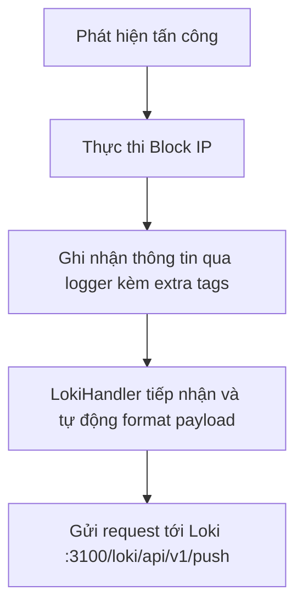

# Báo Cáo Tuần 6

## Zero-Touch IDPS: Logging System Integration

**Thời gian:** 15/05/2026 - 21/05/2026  
**Trạng thái:** ✅ Hoàn thành

---

## Mục lục

1. [Yêu cầu Tuần 6](#1-yêu-cầu-tuần-6)
2. [Triển khai hệ thống](#2-triển-khai-hệ-thống)
   - [2.1 Install Loki on the server](#21-install-loki-on-the-server)
   - [2.2 Push JSON log_entry to Loki](#22-push-json-log_entry-to-loki)
3. [Các thư viện sử dụng](#3-các-thư-viện-sử-dụng)
4. [Các hàm và logic](#4-các-hàm-và-logic)
5. [Kết quả thực thi](#5-kết-quả-thực-thi)
6. [Ảnh chụp màn hình](#6-ảnh-chụp-màn-hình)

---

## 1. Yêu cầu Tuần 6

| # | Yêu cầu | Trạng thái |
|---|---------|-----------|
| 1 | Install Loki on the server | ✅ Hoàn thành |
| 2 | Write function to push JSON log_entry directly to Loki after blocking an IP | ✅ Hoàn thành |

---

## 2. Triển khai hệ thống

### 2.1 Install Loki on the server

#### 2.1.1 Mục tiêu

Cài đặt Grafana Loki trên máy chủ Ubuntu (192.168.226.151) để quản lý và lưu trữ log tập trung, phục vụ cho việc theo dõi các sự kiện bảo mật từ hệ thống IDPS.

#### 2.1.2 Cấu hình Docker Compose

Sử dụng Docker Compose để triển khai Loki.

**File:** `docker-compose.yml` (hoặc cấu hình tương đương)

```yaml
version: "3"
services:
  loki:
    image: grafana/loki:2.8.2
    ports:
      - "3100:3100"
    command: -config.file=/etc/loki/local-config.yaml
    networks:
      - idps_net
```

#### 2.1.3 Các lệnh cài đặt

```bash
# Kéo image Loki về server
docker pull grafana/loki:2.8.2

# Khởi chạy dịch vụ Loki
docker-compose up -d loki

# Kiểm tra trạng thái
docker ps | grep loki
```

Loki sẽ lắng nghe trên cổng `3100` để nhận log đẩy về.

---

### 2.2 Push JSON log_entry to Loki

#### 2.2.1 Mục tiêu

Tạo chức năng tự động đẩy log dạng JSON trực tiếp lên Loki mỗi khi hệ thống thực hiện hành động chặn (block) một địa chỉ IP bằng cách tận dụng chuẩn `logging_loki` của Python.

#### 2.2.2 Tích hợp Loki Handler vào Logger

**File:** `src/autodefense_daemon.py`

Thay vì tự tạo kết nối HTTP thủ công, hệ thống sử dụng thư viện `python-logging-loki` để gắn trực tiếp Loki Handler vào standard logger của Python.

```python
import logging_loki

# Cấu hình URL mặc định của Loki
loki_url = os.getenv("LOKI_URL", "http://192.168.226.151:3100/loki/api/v1/push")

try:
    loki_handler = logging_loki.LokiHandler(
        url=loki_url,
        tags={"application": "idps-autodefense", "env": "production"},
        version="1",
    )
    logger.addHandler(loki_handler)
    logger.info("Đã kết nối với Loki thành công.")
except Exception as e:
    logger.error(f"Không thể kết nối với Loki: {e}")
```

#### 2.2.3 Cấu trúc JSON Log Entry

Khi một IP bị block, ngoài việc đẩy luồng text thông thường qua LokiHandler, hàm `_log_event()` định dạng sự kiện và ghi vào tệp nhật ký giám sát:

```python
def _log_event(src_ip: str, dst_port: int, confidence: float,
               attack_type: str, action: str, response_time_ms: float):
    event = {
        "timestamp": datetime.now(timezone.utc).isoformat(),
        "attacker_ip": src_ip,
        "target_port": dst_port,
        "ml_confidence_score": round(confidence, 4),
        "predicted_threat": attack_type or "Unknown",
        "system_action": action,
        "response_time_ms": round(response_time_ms, 1)
    }

    # Ghi vào action_audit.log dưới dạng JSON-line
    # Loki Agent / Promtail cũng có thể thu thập tệp này nếu cấu hình
    try:
        with open("/app/logs/action_audit.log", "a", encoding="utf-8") as f:
            f.write(json.dumps(event, ensure_ascii=False) + "\n")
    except IOError as e:
        logger.error(f"Không thể ghi action_audit.log: {e}")
```

Bản thân các log block cảnh báo trực tiếp qua logger có dạng text kèm `extra={"tags": {...}}`, sẽ biến thành Label trên Loki.

#### 2.2.4 Tích hợp Log Xác Suất Bổ Sung dạng JSON

Hệ thống ghi log dưới dạng event JSON cho từng giá trị điểm số ML để có thể truy vấn trực tiếp trên Grafana bằng cách kết hợp ghi text JSON và thiết lập extra tags thông qua `logger.info()`.

```python
def _log_probabilities(src_ip: str, dst_port: int, probs: dict):
    """
    Ghi log chuyên biệt chứa các xác suất từ mô hình Multi-class,
    giúp Grafana dễ dàng bóc tách JSON và tạo Panel.
    """
    event = {
        "event_type": "ml_probs",
        "timestamp": datetime.now(timezone.utc).isoformat(),
        "src_ip": src_ip,
        "dst_port": dst_port,
        "probs": probs
    }
    logger.info(
        json.dumps(event, ensure_ascii=False),
        extra={"tags": {
            "application": "idps-autodefense",
            "log_type": "ml_probs",
            "src_ip": src_ip
        }}
    )
```

Tham số `extra={"tags": {...}}` sẽ tương thích với `logging_loki.LokiHandler` thành cấu trúc stream chuẩn.

---

## 3. Các thư viện sử dụng

### 3.1 `python-logging-loki`

```python
import logging_loki
```

| Hàm/Lớp | Mục đích |
|---------|----------|
| `logging_loki.LokiHandler()` | Tạo một Handler cho module `logging` mặc định của Python |
| `tags={...}` | Thêm nhãn (label) cố định cho luồng log gửi đến Loki |
| `logger.addHandler()` | Gắn Handler vào logger chính để đồng bộ output tới backend Loki |

### 3.2 `json` & `datetime`

```python
import json
from datetime import datetime, timezone
```

| Hàm | Mục đích |
|-----|----------|
| `json.dumps()` | Chuyển đổi dictionary event của Python thành chuỗi JSON |
| `datetime.now(timezone.utc).isoformat()` | Lấy timestamp theo chuẩn ISO-8601 UTC để định dạng chính xác sự kiện |

---

## 4. Các hàm và logic

| Hàm (trong `autodefense_daemon.py`) | Chức năng |
|-----|-----------|
| Khởi tạo `LokiHandler` | Cấu hình tham số và kết nối đến endpoint HTTP API v1 Push của Loki |
| `_log_event()` | Tạo đối tượng event dạng JSON theo định dạng chuẩn, ghi nhận các hoạt động AUTO_BLOCKED |
| `_log_probabilities()` | Tạo JSON ghi lại chi tiết log xác suất của multi-class model. Truyền cấu trúc `tags` qua tham số `extra` để Loki phân index. |

**Luồng hoạt động (Workflow):**



---

## 5. Kết quả thực thi

### 5.1 Kiểm tra Loki đang chạy

```bash
curl -s http://192.168.226.151:3100/ready
```
**Kết quả mong đợi:** `ready`

### 5.2 Kiểm tra log đẩy lên Loki

Sử dụng giao diện Grafana (Explore Data) để truy vấn log đã được đẩy lên bằng Handler Python.

**LogQL Query:**
```logql
{application="idps-autodefense", log_type="ml_probs"}
```

**Kết quả mong đợi:**
Sẽ thấy các dòng log JSON ghi nhận xác suất đã phân tích:
```json
{"event_type": "ml_probs", "timestamp": "2026-05-15T14:30:00+00:00", "src_ip": "192.168.226.205", "dst_port": 22, "probs": {"Brute Force": 0.95}}
```

---

## 6. Ảnh chụp màn hình

### 6.1 Trạng thái Loki container

> **[CHÈN ẢNH CHỤP MÀN HÌNH TẠI ĐÂY]**
> 
> Ảnh minh họa: Output của `docker ps` cho thấy container `loki` đang hoạt động (Up) và listen port `3100`.

---

### 6.2 Log truy vấn trên Grafana (Explore)

> **[CHÈN ẢNH CHỤP MÀN HÌNH TẠI ĐÂY]**
> 
> Ảnh minh họa: Màn hình Explore của Grafana, truy vấn bằng LogQL `{application="idps-autodefense"}` và hiển thị dữ liệu JSON log_entry vừa được push từ Python script.

---

## 7. Tóm tắt

Tuần 6 đã hoàn thành tích hợp thành công hệ thống lưu trữ log tập trung Loki:

1. **Install Loki**: Đã triển khai Grafana Loki thành công qua Docker trên server `192.168.226.151`.
2. **Push JSON log_entry**: Thay vì phải tự cài module API cồng kềnh, hệ thống sử dụng module `logging_loki` (LokiHandler) tích hợp trực tiếp vào standard logger của Python trong file `src/autodefense_daemon.py`. Việc tạo payload và thiết lập header HTTP được Handler tự động xử lý. Mỗi khi chặn một IP, mã nguồn ghi nhận sự kiện dưới dạng JSON string thông qua `_log_probabilities` cùng các tag index (gửi qua thuộc tính `extra`) giúp cho việc truy vấn LogQL trở nên hiệu quả và tự động.

---

**Báo cáo được tạo:** Tuần 6 (15/05/2026 - 21/05/2026)  
**Trạng thái:** ✅ Hoàn thành
