# BÁO CÁO CHI TIẾT TUẦN 8: XÂY DỰNG HỆ THỐNG HYBRID DETECTION (SURICATA & ML)

**Thời gian:** 29/05/2026 - 04/06/2026  
**Trạng thái:** ✅ Hoàn thành

---

## MỤC LỤC
1. [Yêu cầu Tuần 8](#1-yêu-cầu-tuần-8)
2. [Triển khai Container Nginx (Reverse Proxy & TLS Termination)](#2-triển-khai-container-nginx-reverse-proxy--tls-termination)
3. [Cài đặt Suricata và Custom Rules (Layer 7 DPI)](#3-cài-đặt-suricata-và-custom-rules-layer-7-dpi)
4. [Xây dựng Suricata Correlation (Hợp nhất ML L3/L4 và Suricata L7)](#4-xây-dựng-suricata-correlation-hợp-nhất-ml-l3l4-và-suricata-l7)
5. [Khắc phục sự cố Logic Correlation (False Positive Debugging)](#5-khắc-phục-sự-cố-logic-correlation-false-positive-debugging)
6. [Tổng kết và Đánh giá](#6-tổng-kết-và-đánh-giá)

---

## 1. YÊU CẦU TUẦN 8

Mục tiêu cốt lõi của tuần 8 là giải quyết "điểm mù" của Machine Learning. Mô hình XGBoost phân tích 15 đặc trưng thống kê luồng mạng (NFStream) cực kỳ xuất sắc với DDoS, Port Scan, Brute-force nhưng hoàn toàn bất lực trước các tấn công tầng ứng dụng (Web Attacks như SQLi, XSS) vì không thể kiểm tra nội dung payload (Deep Packet Inspection).

**Các hạng mục thực hiện:**
1. **Container Nginx:** Đứng làm Reverse Proxy giải mã HTTPS để lấy Plaintext.
2. **Install Suricata:** Quét Plaintext HTTP để tìm dấu hiệu độc hại Layer 7.
3. **Suricata Correlation:** Hợp nhất (Fusion) quyết định giữa ML và Suricata.

---

## 2. TRIỂN KHAI CONTAINER NGINX (REVERSE PROXY & TLS TERMINATION)

### 2.1 Vấn đề HTTPS Mã Hóa
Toàn bộ traffic web thực tế đều qua HTTPS. Suricata không thể quét mã độc trong luồng dữ liệu đã bị mã hóa end-to-end. Giải pháp là thiết lập Nginx đứng trước để giải mã SSL (TLS Termination), sau đó truyền Plaintext HTTP ở mạng nội bộ `br-idps` để Suricata sniff.

### 2.2 Quá trình thực hiện
Tôi đã tạo cấu trúc dịch vụ `nginx` hoàn toàn mới trong thư mục `docker/nginx`:

**1. Tạo `Dockerfile` tối ưu:**
Sử dụng `nginx:alpine` siêu nhẹ và cài đặt thêm `openssl`.
```dockerfile
FROM nginx:alpine
RUN apk add --no-cache openssl bash
COPY nginx.conf /etc/nginx/nginx.conf
COPY entrypoint.sh /entrypoint.sh
RUN chmod +x /entrypoint.sh
ENTRYPOINT ["/entrypoint.sh"]
```

**2. Script `entrypoint.sh` sinh Self-Signed Certificate:**
Đảm bảo hệ thống tự động sinh cert HTTPS ngay lần chạy đầu tiên để không phải cấu hình tay.
```bash
openssl req -x509 -nodes -days 365 -newkey rsa:2048 \
    -keyout /etc/nginx/certs/key.pem \
    -out /etc/nginx/certs/cert.pem \
    -subj "/C=VN/ST=HCM/L=HCM/O=IDPS/OU=Dev/CN=localhost"
```

**3. Cấu hình `nginx.conf` truyền X-Forwarded-For (XFF):**
Đây là bước quan trọng nhất. Nếu không có XFF, Suricata sẽ lầm tưởng IP của kẻ tấn công chính là IP của Nginx (`172.x.x.x`). 
```nginx
server {
    listen 443 ssl;
    ssl_certificate /etc/nginx/certs/cert.pem;
    ssl_certificate_key /etc/nginx/certs/key.pem;

    location / {
        proxy_pass http://juice-shop:3000;
        proxy_set_header X-Real-IP $remote_addr;
        # Truyền IP thật của Client vào header XFF
        proxy_set_header X-Forwarded-For $proxy_add_x_forwarded_for;
        proxy_set_header X-Forwarded-Proto $scheme;
    }
}
```

---

## 3. CÀI ĐẶT SURICATA VÀ CUSTOM RULES (LAYER 7 DPI)

### 3.1 Chỉnh sửa Docker Compose & Interface
Trong `docker-compose.yml`, Suricata được thiết lập `depends_on: nginx` và được cấu hình để lắng nghe thêm trên interface ảo `br-idps` (bridge network nơi luồng HTTP plaintext từ Nginx đi qua).
Cơ chế chia sẻ volume được thêm vào: Nginx và Suricata ghi log chung, và Autodefense daemon đọc `eve.json` với quyền `ro` (read-only).

### 3.2 Kích hoạt XFF Parser qua `patch_config.sh`
Tôi đã viết script tự động sửa đổi file `suricata.yaml` trong lúc build Docker để cấu hình Suricata lấy IP thật từ Header HTTP thay vì IP mạng nội bộ.
```yaml
# Nội dung patch_config.sh áp dụng vào suricata.yaml
xff:
  enabled: yes
  mode: overwrite  # Cực kỳ quan trọng: Ghi đè src_ip bằng IP từ XFF
  header: X-Forwarded-For
```

### 3.3 Thiết kế Custom Rules cho Web Attacks
Mô hình ML "mù" trước Web Attack, do đó tôi đã viết bổ sung 11 bộ luật chuyên biệt tại `docker/suricata/custom-rules/local.rules` với hành động khẩn cấp là `drop`:
```suricata
# Phát hiện SQL Injection
alert http $EXTERNAL_NET any -> $HTTP_SERVERS any (msg:"SQLi - UNION SELECT"; flow:established,to_server; content:"UNION"; content:"SELECT"; within:20; classtype:web-application-attack; sid:1000001; rev:1;)

# Phát hiện Cross-Site Scripting (XSS)
alert http $EXTERNAL_NET any -> $HTTP_SERVERS any (msg:"XSS - Script Tag"; flow:established,to_server; content:"<script"; nocase; classtype:web-application-attack; sid:1000010; rev:1;)

# Path Traversal
alert http $EXTERNAL_NET any -> $HTTP_SERVERS any (msg:"Path Traversal"; flow:established,to_server; content:"../"; content:"../"; within:10; classtype:web-application-attack; sid:1000030; rev:1;)
```

---

## 4. XÂY DỰNG SURICATA CORRELATION (HỢP NHẤT ML L3/L4 VÀ SURICATA L7)

### 4.1 Cơ chế hoạt động tổng thể

Tôi đã hiện thực hóa thuật toán tương quan điểm số (Correlation) trong codebase Python, kết nối 2 thành phần độc lập lại thành một bộ máy phòng thủ Hybrid thống nhất.

Sơ đồ luồng xử lý từ lúc nhận flow đến lúc ra quyết định:

```mermaid
flowchart TD
    A[NFStream Flow] --> B{Blacklist?}
    B -->|YES| B1[Re-enforce iptables DROP - Skip ML]
    B -->|NO| C{Whitelist?}
    C -->|YES| C1[BENIGN - bỏ qua]
    C -->|NO| D[Trích xuất 15 Features - NFStream]

    D --> E[XGBoost Binary]
    E --> F[XGBoost Multiclass]
    F --> G["Kết quả ML: ml_confidence, ml_attack_type"]

    G --> H["Gọi correlator.correlate()"]

    subgraph CORR ["⚡ suricata_correlator.correlate()"]
        H1{Có alerts cho src_ip\ntrong 5 phút gần nhất?}
        H1 -->|KHÔNG| H2["correlation_score = 0.0"]
        H1 -->|CÓ| R1

        R1{"ml_attack_type có giá trị?\n(ML phát hiện tấn công)"}

        R1 -->|CÓ| R2{"Số lượng alerts?"}
        R2 -->|">= 3 alerts"| R3["Repeat offender +0.15\ncorrelation_score += 0.15"]
        R2 -->|">= 2 alerts"| R4["correlation_score += 0.05"]
        R2 -->|"< 2 alerts"| LOOP
        R3 --> LOOP
        R4 --> LOOP
        R1 -->|KHÔNG| LOOP

        LOOP["Vòng lặp từng alert\ntừ EVE JSON cache"]

        LOOP --> LA{"ml_attack_type\nrỗng/None?"}
        LA -->|"YES - ML Benign"| A1["Nhánh A: +0.10\n/ loại tấn công DUY NHẤT"]
        LA -->|NO| LB{"suricata_type\n== ml_type?"}
        LB -->|"YES - Cùng loại"| B2["Nhánh B: +0.20\nXác nhận chéo"]
        LB -->|"NO - Khác loại"| LC{"suricata_type\ncó giá trị?"}
        LC -->|YES| C2["Nhánh C: +0.30\nĐa hình thái tấn công"]
        LC -->|NO| NEXT

        A1 --> DROP
        B2 --> DROP
        C2 --> DROP
        NEXT --> DROP

        DROP{"action = drop/blocked/reject\nvà SID chưa tính?"}
        DROP -->|"CÓ - Custom L7 Rule"| D1["correlation_score += 0.50\nDedup theo signature_id"]
        DROP -->|KHÔNG| NEXT2
        D1 --> NEXT2

        NEXT2["Lặp alert tiếp theo"] --> LOOP_END{"Còn alert?"}
        LOOP_END -->|CÓ| LOOP
        LOOP_END -->|HẾT| SEV

        SEV["Nhân toàn bộ điểm:\ncorrelation_score ×= severity_boost\n INFO→0.30  Warning→0.50"]

        SEV --> CAP{"ml_attack_type\nrỗng/None?"}
        CAP -->|"YES - ML Benign"| CAP1["Hard cap ≤ 0.30\n(suricata_only_max_score)"]
        CAP -->|"NO - ML Attack"| CAP2["Cap ≤ 0.90"]
    end

    H --> H1
    CAP1 --> FUSION
    CAP2 --> FUSION
    H2 --> FUSION

    FUSION["final_confidence =\nmin(ml_confidence + correlation_score, 1.0)"]

    FUSION --> OVR{"suricata_action_drop = True?"}
    OVR -->|CÓ| OVR1["SURICATA OVERRIDE:\nis_attack = True\nfinal_confidence = max score, 0.90"]
    OVR -->|KHÔNG| DEC

    OVR1 --> DEC{"So sánh Thresholds"}

    DEC -->|"final_confidence > 0.85"| Y["🔴 AUTO_BLOCKED\niptables DROP + Blacklist"]
    DEC -->|"final_confidence > 0.60"| Z["🟡 SUSPICIOUS\nLog cảnh báo - Monitor tiếp"]
    DEC -->|"final_confidence <= 0.60"| AA["🟢 BENIGN\nCho qua"]
```




### 4.2 Công thức tính điểm chi tiết

#### Bước 1: Tính `correlation_score` (trong `suricata_correlator.py`)

Phụ thuộc hoàn toàn vào kết quả ML và dữ liệu EVE JSON của Suricata trong 5 phút gần nhất:

| Điều kiện | Điểm cộng | Ghi chú |
|:----------|:---------:|:--------|
| **ML Benign** + Suricata có alert → Nhánh A | `+0.10` / loại | Khử trùng bằng `set()`, cap cứng ≤ 0.30 |
| **ML Attack** = Suricata (cùng loại) → Nhánh B | `+0.20` / loại | Xác nhận chéo (Cross-validation) |
| **ML Attack** ≠ Suricata (khác loại) → Nhánh C | `+0.30` / loại | Đa hình thái tấn công - rất nguy hiểm |
| **Repeat offender** (≥ 3 alerts, ML có tín hiệu) | `+0.15` | Chỉ áp dụng khi ML đã phát hiện |
| **Repeat offender** (≥ 2 alerts, ML có tín hiệu) | `+0.05` | |
| **action=drop** (Custom L7 Rule) | `+0.50` | Mỗi `signature_id` chỉ tính 1 lần |

Sau khi tổng hợp, nhân toàn bộ điểm với `severity_boost` (hệ số mức độ nghiêm trọng cao nhất của batch alerts):

| Severity | Nhãn | Hệ số nhân | Quan sát thực tế |
|:---:|:---|:---:|:---|
| 1 | INFO (ET POLICY, ET INFO) | `× 0.30` | ✅ Phổ biến — SSL policy, HTTP header |
| 2 | Warning | `× 0.50` | ✅ Thường gặp — ET Open detection rules |
| 3 | Notice | `× 0.70` | ⚠️ Được định nghĩa trong code, chưa quan sát thấy |
| 4 | Critical | `× 0.85` | ⚠️ Được định nghĩa trong code, chưa quan sát thấy |

> **Ghi chú thực tế:** Trong quá trình vận hành với ruleset ET Open mặc định, hệ thống chỉ ghi nhận được severity **1 (INFO)** và **2 (Warning)**. Severity 3 và 4 được định nghĩa sẵn trong `_severity_weights` như một cơ chế dự phòng cho trường hợp deploy ruleset cao cấp hơn trong tương lai (ví dụ: ET Pro hoặc custom rules nặng tay hơn).

#### Bước 2: Tính `final_confidence` (trong `autodefense_daemon.py`)

```
final_confidence = min(ml_confidence + correlation_score, 1.0)

Nếu Suricata có action=drop (Custom L7 Rule kích hoạt):
    is_attack = True (bắt buộc, dù ML nói BENIGN)
    final_confidence = max(final_confidence, 0.90)  ← Bắt buộc vượt ngưỡng Auto-Block
```

#### Bước 3: Ra quyết định dựa vào Thresholds

```
if is_attack AND final_confidence > 0.85:
    → AUTO_BLOCKED (iptables DROP + thêm Blacklist)

elif final_confidence > 0.60:
    → SUSPICIOUS (Chỉ log cảnh báo, monitor tiếp)

else:
    → BENIGN (Cho qua)
```

### 4.3 Ví dụ minh họa thực tế

**Kịch bản 1: Kali Linux duyệt web bình thường (False Positive trước khi fix)**
```
ML:          bin=0.008, multi=0.002 → attack_type=None, confidence=0.008 (BENIGN)
Suricata:    3 alerts ET INFO (SSL policy) → severity=1 → severity_weight=0.30
             Nhánh A: +0.10 × 1 loại = 0.10
             correlation_score = 0.10 × 0.30 = 0.03  (sau khi nhân severity)
             Hard cap: min(0.03, 0.30) = 0.03
final_confidence = min(0.008 + 0.03, 1.0) = 0.038 → BENIGN ✅
```

**Kịch bản 2: SQL Injection thật (action=drop từ Custom Rule)**
```
ML:          bin=0.65, multi=0.58 → attack_type="Web Attack", confidence=0.65
Suricata:    SID:1000001 (UNION SELECT) → action=drop → +0.50
             correlation_score = 0.50 × severity_boost(0.85) = 0.425
             Cap: min(0.425, 0.90) = 0.425
final_confidence = min(0.65 + 0.425, 1.0) = 1.00
Suricata Override: final_confidence = max(1.00, 0.90) = 1.00
→ AUTO_BLOCKED ✅
```

### 4.4 Tinh chỉnh Ngưỡng (Thresholds)

Cập nhật tệp cấu hình trung tâm `configs/thresholds.json`:
- `auto_block_threshold`: Nâng từ 0.80 lên **0.85** (vì điểm Fusion giờ đây được cộng thêm).
- `alert_threshold`: Tăng từ 0.35 lên **0.60**.
- `suricata_only_max_score`: **0.30** — giới hạn tổng correlation score khi ML=Benign để ET Open alerts không thể tự kích hoạt block.


---

## 5. KHẮC PHỤC SỰ CỐ LOGIC CORRELATION (FALSE POSITIVE DEBUGGING)

Ngay sau khi tích hợp, tôi phát hiện một lỗi cực kỳ nghiêm trọng trong hệ thống: **Chỉ cần một máy tính dùng hệ điều hành Kali Linux duyệt web bình thường vào trang chủ (không tấn công), điểm số đã bị nhảy lên 0.908 (SUSPICIOUS) và xém chút bị khóa mạng.** Trong khi đó ML đang chấm đúng là BENIGN (0.008).

### 5.1 Chẩn đoán Root Cause
Sau khi phân tích log và cấu trúc code, tôi đã chỉ ra 3 lỗi thiết kế:
1. **Lỗi Logic "Different Attack Types":** Hàm correlate() cộng ngay `0.30` khi loại tấn công của Suricata khác với ML. Nhưng khi ML báo BENIGN (không có tấn công), mọi alert của Suricata vô tình bị đánh giá là "Đa hình thái tấn công".
2. **Lỗi Score Inflation (Cộng dồn vô hạn):** Suricata cài bộ luật ET Open mặc định văng ra hàng loạt cảnh báo "thông tin" (INFO) như lỗi chứng chỉ SSL, HTTP Header bất thường. Vòng lặp code cũ cứ mỗi alert là cộng dồn `0.30` đẩy vọt điểm lên `0.90` chỉ trong chớp mắt.
3. **Bỏ quên Severity:** Alert mức độ nghiêm trọng 1 (INFO) hay 4 (CRITICAL) đều được xử lý ngang nhau.

### 5.2 Xử lý mã nguồn
Tôi đã đập đi xây lại hàm `correlate()` để giải quyết triệt để vấn đề:

**1. Khử trùng lặp (Deduplication) bằng `Set()`:**
```python
seen_attack_types = set()
for alert in alerts:
    if alert.signature not in seen_attack_types:
        seen_attack_types.add(alert.signature)
        # Bắt đầu tính điểm...
```

**2. Kích hoạt ML Confidence Gating:**
Sửa lại kiến trúc quyết định. Điểm "Different attack types" chỉ được kích hoạt nếu bản thân Machine Learning cũng tự tin rằng đang có dấu hiệu tấn công (`ml_confidence >= alert_threshold`). 
Nếu ML cho rằng đây là traffic sạch, áp dụng nhánh `suricata_only_detection` với số điểm cực kỳ nhỏ (`0.10`) để tránh đẩy điểm lên quá ngưỡng chặn.

**3. Nhân trọng số Severity Thực Tế:**
```python
# Alert INFO chỉ còn 30% sức ảnh hưởng so với Alert CRITICAL
severity_boost = 0.3 + (alert.severity * 0.15)
correlation_score += (0.15 * severity_boost) 
```

**Kết quả sau khi fix:**
Traffic hợp lệ từ Kali Linux đã sụt điểm từ **0.908** xuống mức an toàn tuyệt đối **0.098 (BENIGN)**. Đồng thời, tấn công SQL Injection thật sự vẫn kích hoạt Override và khóa cứng ở **1.000 (AUTO_BLOCKED)**.

---

## 6. TỔNG KẾT VÀ ĐÁNH GIÁ

Quá trình hoàn thành 3 yêu cầu trong tuần 8 đã biến đổi kiến trúc dự án IDPS từ một công cụ ML thuần túy thành một cỗ máy **Hybrid Detection System chuyên nghiệp**:
1. **Bảo mật chiều sâu (Defense in Depth):** Nginx giải mã TLS, Suricata kiểm tra Payload Layer 7, và XGBoost phân tích hành vi Network Layer 3/4.
2. **Zero-Touch chuẩn xác:** Nhờ quá trình gỡ lỗi logic Correlation tinh vi, hệ thống đã bù trừ được ưu/khuyết của hai công nghệ: ML chặn Zero-day/DDoS không có chữ ký, Suricata chặn chính xác XSS/SQLi không có hành vi bất thường, và quá trình hợp nhất (Fusion) không để lại "tác dụng phụ" False Positive nào trên môi trường thực tế.

---

**Báo cáo được tạo:** Tuần 8 (29/05/2026 - 04/06/2026)  
**Trạng thái:** ✅ Hoàn thành
